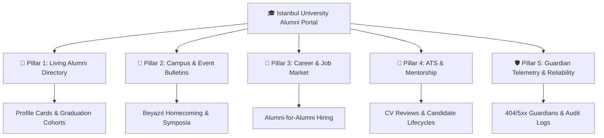

# 🏛️ Istanbul University Alumni Tracking System — Brand & Platform Vision Guide

> **Institution:** Istanbul University (*İstanbul Üniversitesi*)  
> **Heritage:** Founded in 1453 &bull; Turkey’s Foremost Institution of Higher Education  
> **Platform Version:** 2.0.0  
> **Document Status:** Active Architectural & Brand Specification  
> 🔗 **Technical Manuals:** [README.md](./README.md) &bull; [Design System (design.md)](./design.md) &bull; [Data Design Documentation (ddd.md)](./ddd.md) &bull; [Interactive Swagger API](http://localhost:3000/api/swagger)

---

## 📑 Table of Contents

1. [Executive Summary & Purpose](#1-executive-summary--purpose)
2. [Vision & Mission Statements](#2-vision--mission-statements)
3. [Institutional Context & The 1453 Legacy](#3-institutional-context--the-1453-legacy)
4. [Core Platform Pillars](#4-core-platform-pillars)
   - [Pillar 1: Living Alumni Directory & Global Network](#pillar-1-living-alumni-directory--global-network)
   - [Pillar 2: Campus Announcements & Traditions](#pillar-2-campus-announcements--traditions)
   - [Pillar 3: Career & Opportunity Exchange](#pillar-3-career--opportunity-exchange)
   - [Pillar 4: Candidate Tracking & Mentorship](#pillar-4-candidate-tracking--mentorship)
   - [Pillar 5: Digital Observability & Guardian Reliability](#pillar-5-digital-observability--guardian-reliability)
5. [Target Audience Personas](#5-target-audience-personas)
6. [Brand Voice & Tone Guidelines](#6-brand-voice--tone-guidelines)
7. [Visual Identity & Design System](#7-visual-identity--design-system)
8. [Ethical Data Governance & Privacy](#8-ethical-data-governance--privacy)
9. [Platform Roadmap & Future Horizons](#9-platform-roadmap--future-horizons)
10. [Complete Front-End Experience & Page Ecosystem (14 Screens)](#10-complete-front-end-experience--page-ecosystem-14-screens)

---

## 1. Executive Summary & Purpose

The **Istanbul University Alumni Tracking System** (*İstanbul Üniversitesi Mezun Takip Sistemi*) is the official, next-generation digital ecosystem engineered to unite, celebrate, and empower generations of Istanbul University graduates across the globe.

### Why This Platform Exists

Istanbul University holds a unique position in world academic history: its roots trace back to **1453**, and over nearly six centuries it has produced world-renowned scientists, Nobel laureates, prime ministers, jurists, physicians, engineers, artists, and business leaders. However, due to the sheer size of the student body and its multifaceted faculty structure, graduates have historically experienced fractured post-graduation networks:

- **Disconnected Networks:** Hundreds of thousands of graduates lose contact with classmates, faculty mentors, and academic developments once they leave the historic Beyazıt or Avcılar campuses.
- **Untapped Mentorship Capital:** Seasoned alumni leading international tech companies, hospitals, and legal firms lack a centralized, reputable channel to recruit young Istanbul University talent.
- **Fragmented Announcements:** University reunions (*Mezunlar Günü*), academic symposia, and institutional updates are scattered across disparate social channels without a single source of truth.
- **Career Opportunity Gaps:** Recent graduates often face competitive job markets without direct access to the alumni referral network that other global institutions offer.

This platform bridges these gaps through a **unified, enterprise-grade, and beautifully designed Model-View-Controller (MVC) web application**. It provides a living directory, verified bulletins, an alumni-driven job market, applicant tracking, and interactive REST APIs.

---

## 2. Vision & Mission Statements

### 🌟 Vision Statement
> *"To forge an interconnected, enduring, and intellectually vibrant global alumni community that carries Istanbul University's six-century legacy into the digital age — empowering every graduate to achieve their highest career potential and pass the torch of knowledge to future generations."*

### 🎯 Mission Statement
> *"To deliver a modern, secure, and user-centric web platform that empowers Istanbul University alumni to maintain lifelong ties with their alma mater, discover fellow graduates, exchange high-impact career opportunities, mentor current students, and actively contribute to the academic and social prestige of Istanbul University."*

---

## 3. Institutional Context & The 1453 Legacy

### The Heritage
Istanbul University's historic central campus gate at **Beyazıt Square** is an iconic symbol of Turkish science and enlightenment. As the direct successor of the *Sahn-ı Seman* medreses established following the conquest of Istanbul in 1453, the institution has educated pioneers across every discipline:

- **Nobel Laureate Pride:** Prof. Dr. Aziz Sancar (Chemistry Nobel, Istanbul Faculty of Medicine alumnus) and Orhan Pamuk (Literature Nobel).
- **Comprehensive Academic Scope:** Encompassing faculties in Computer & Software Engineering, Medicine, Law (*Hukuk Fakültesi* — Turkey's oldest law school), Economics (*İktisat Fakültesi*), Letters (*Edebiyat Fakültesi*), Science (*Fen Fakültesi*), Communication (*İletişim*), Pharmacy, Dentistry, and Aquatic Sciences.

### Modern Brand Essence
The Alumni Tracking System reflects both the **grandeur of this historical foundation** and the **agility of contemporary 21st-century software engineering**:
- **Prestigious yet Accessible:** Dignified in tone, yet simple and responsive on any smartphone or browser.
- **Open yet Secure:** Seamless public directories with robust input validation, SQL injection prevention, and XSS sanitization.
- **Resilient by Design:** Backed by PostgreSQL 16 persistence and a specialized Guardian middleware pipeline that guarantees no cryptic errors or broken links disrupt the alumni experience.

---

## 4. Core Platform Pillars

The application is structured around five strategic pillars, each fulfilling an essential community need:



### Pillar 1: Living Alumni Directory & Global Network
- **Dynamic Cohort Filtering:** Filter and locate alumni by graduation year (e.g., 1995, 2010, 2024), faculty, and department (*Computer Engineering, Law, Economics, etc.*).
- **Rich Profile Cards:** Profile detail pages displaying graduation honors, professional bios, department affiliations, and contact preferences.
- **Nested Relational History:** Single-click navigation into an alumnus's published career opportunities (`/users/:userId/jobs`) and community application records (`/users/:userId/applications`).
- **Data Integrity:** Strict email uniqueness and positive numeric parameter checks (`USR-R1`, `USR-R2`).

### Pillar 2: Campus Announcements & Traditions
- **Official Institutional Bulletins:** Direct communication channel for the Rectorate, Alumni Association (*Mezunlar Derneği*), and individual departments.
- **Campus Gatherings:** Dedicated event publishing for annual Beyazıt Homecoming Days (*Geleneksel Mezunlar Günü*), faculty jubilees, seminars, and networking galas.
- **Category Taxonomy:** Structured classifications (*Academic, Social, Career, Administrative, Sports*).

### Pillar 3: Career & Opportunity Exchange
- **Alumni-Powered Hiring:** Senior graduates post verified openings at their companies for fellow alumni and graduating seniors.
- **Transparent Role Specifications:** Clear job descriptions, experience requirements, work arrangements (*Full-time, Part-time, Remote, Hybrid*), and salary ranges.
- **Domain Business Rules:** Adherence to strict data contracts (`JP-R1`–`JP-R7`: title length caps, verified email contacts, foreign key validation to publishing user).

### Pillar 4: Candidate Tracking & Mentorship
- **Integrated Applicant Tracking (ATS):** Candidates apply directly with verified CV links and tailored cover notes.
- **Status Lifecycle:** Review progress tracked through standardized states (`Pending`, `Reviewed`, `Accepted`, `Rejected`) with full recruiter controls (`APP-R1`–`APP-R6`).
- **Anti-Duplication Safety:** Composite unique constraints prevent duplicate submissions for the same position by the same applicant.

### Pillar 5: Digital Observability & Guardian Reliability
- **404 Guardian:** Automated typo detection suggests closest routes, blocks open-redirect attacks, and gracefully routes browser requests to `/404?from=...`.
- **5xx Server Guardian:** Classifies database, query, template, and gateway exceptions, generates unique `ERR-*` Incident IDs, and redacts sensitive server internals in production.
- **Dual-Sink Telemetry:** Every request logs structured execution times, HTTP status codes, and payload sizes to the console and persistent `logs/error.logs`.

---

## 5. Target Audience Personas

| Persona | Role | Primary Needs | Key Platform Touchpoints |
| :--- | :--- | :--- | :--- |
| **Emre (Recent Graduate)** | B.S. in Computer Engineering, Class of 2025 | First professional role, resume review, networking with senior engineering alumni | `/jobs`, `/applications`, `/users` |
| **Ayşe (Senior Executive)** | B.A. in Law, Class of 2008 &bull; Legal Partner | Recruiting qualified junior lawyers, mentoring students, staying connected to faculty | `/jobs` (post role), `/announcements` |
| **Mehmet (Current Student)** | 3rd Year Economics Undergrad | Finding summer internships, attending campus networking events and seminars | `/jobs` (internships), `/announcements` |
| **Zeynep (Alumni Association Admin)**| Coordinator, IU Alumni Office | Publishing official bulletins, tracking graduate placement, organizing Homecoming | `/announcements`, `/api/swagger`, `/users` |
| **Developer / Evaluator** | Software Engineer or Auditor | Inspecting MVC architecture, API endpoints, testing pipelines, and DDD schemas | `/api/swagger`, [README.md](./README.md), [ddd.md](./ddd.md) |

---

## 6. Brand Voice & Tone Guidelines

The Istanbul University Alumni Tracking System communicates with a distinct voice that honors history while embracing modernity:

| Dimension | Our Tone | What We Avoid | Example Copy |
| :--- | :--- | :--- | :--- |
| **Authority** | Prestigious, academic, dignified | Stuffy, bureaucratic, archaic | *"Honoring 1453 heritage through modern graduate connectivity."* |
| **Warmth** | Welcoming, collegial, inclusive | Impersonal, corporate, cold | *"Welcome back to your alma mater community."* |
| **Clarity** | Direct, functional, unambiguous | Tech jargon, vague promises | *"Application received. Review status: Pending."* |
| **Error Handling** | Helpful, diagnostic, solution-oriented | Cryptic stack traces, dead-ends | *"No page matched '/usres'. Did you mean '/users'?"* |

---

## 7. Visual Identity & Design System (İÜ AKSİS & ÖYS Standard)

The front-end design system reflects the official corporate, fresh, and modern design standards of Istanbul University's primary student and administrative portals (**AKSİS & ÖYS**):

### Institutional Vector Emblem & Identity
- **Official Emblem (`/images/iu-logo.png`):** Scalable vector seal featuring the historical founding year (**1453**), the iconic Beyazıt campus entrance gate arch, and gold & deep navy academic accents.
- **Sidebar Brand Header:** Prominently placed in the upper-left sidebar with the official emblem and uppercase institutional title: `"İSTANBUL ÜNİVERSİTESİ - Mezun Takip Sistemi"`.

### Corporate Color Palette

| Token / Color | Hex Value | Role & Usage |
| :--- | :--- | :--- |
| **Primary Corporate Accent** | `#1D8CF8` / `#0F7AE5` | Active tabs, primary action buttons, active navigation indicator bar |
| **Cool Gray Canvas** | `#F4F6F9` | Main content body background across all screens |
| **Card & Sidebar Surface** | `#FFFFFF` | Collapsible left sidebar, top header bar, and elevated content cards |
| **Soft Input Gray** | `#F5F7FA` | Form inputs, select dropdowns, search bars, and table header rows |
| **Subtle Border** | `#E5E7EB` | Sidebar right border, top header bottom border, card divider lines |
| **Text Primary (Anthracite)** | `#1E293B` | High-contrast headings, card titles, key KPI numbers |
| **Text Secondary** | `#334155` | Regular body copy, table row data, form labels |
| **Text Muted** | `#64748B` | Secondary metadata, dates, breadcrumbs, role subtitles |
| **Accent Green** | `#2E7D32` (`#E8F5E9`) | Career listings, active opportunities, success status badges |
| **Accent Orange** | `#F59E0B` (`#FEF3C7`) | Announcements, campus events, warning badges |
| **Accent Purple** | `#7C3AED` (`#F3E8FF`) | ATS candidate applications, academic programs |
| **Accent Navy** | `#1E293B` (`#F1F5F9`) | System governance, administrative controls, dark badges |
| **Accent Red** | `#DC2626` (`#FEE2E2`) | Delete actions, session logout, error and rejection alerts |
| **Accent Sky Blue** | `#0284C7` (`#E0F2FE`) | Alumni directory, general institutional information |
| **Accent Coral** | `#F88379` (`#FFF1F0`) | Student programs, verified mentorship indicators |

### Page Layout & Component Architecture

1. **Collapsible Left Sidebar (`#appSidebar`):**
   - Fixed 260px vertical menu with `#FFFFFF` background and thin right border (`#E5E7EB`).
   - Top brand header featuring the vector IU logo and system title.
   - Clean navigation links with subtle gray icons; active item highlighted in corporate blue (`#1D8CF8`) with soft blue background and blue indicator border.
2. **Top Header Bar (`.app-header`):**
   - Clean white bar (`#FFFFFF`) with thin bottom border (`#E5E7EB`).
   - Left side hosts the mobile hamburger toggle and current page title/breadcrumb.
   - Right side hosts live system status, authenticated role pill/avatar, and quick action buttons.
3. **Cool Light Gray Main Content Canvas (`.app-content-body`):**
   - High-contrast `#F4F6F9` canvas wrapping all content in rounded white cards (`#FFFFFF`, `8px-12px` border radius, subtle drop shadow).
4. **Dashboard & Quick-Access Cards:**
   - 2 or 3 column responsive grid; each card features a colored square icon box on the left, title and description in the middle, and subtle rightward arrow (`>`) on the right.
5. **Profile, Detail & Form Cards:**
   - Horizontal tabs with corporate blue underline for active tab.
   - 2-column input forms on soft gray `#F5F7FA` background with smooth rounded corners (`8px`).
   - Standardized button hierarchy: primary filled blue (`#1D8CF8`), secondary outline (`#D1D5DB`), and danger red (`#FEE2E2` / `#DC2626`) right-aligned with consistent spacing.
6. **Spacious Data Tables:**
   - Generous cell padding (14px-18px), soft gray headers (`#F8FAFC`), and subtle hover row highlight (`#F8FAFC`).

---

## 8. Ethical Data Governance & Privacy

Istanbul University takes data privacy and institutional trust seriously:

1. **Explicit Data Minimization:** Only professional contact details, graduation years, and career information are maintained for alumni networking.
2. **Strict Sanitization:** All user inputs (descriptions, requirements, cover notes) undergo automated HTML entity escaping and script tag stripping to prevent XSS.
3. **No Third-Party Trackers:** Zero third-party ad networks, telemetry trackers, or invasive analytics cookies are embedded.
4. **Relational Constraints:** Cascading deletes and foreign key validations ensure clean database states without orphaned user records.

---

## 9. Platform Roadmap & Future Horizons

The current release (**v2.0.0**) establishes the core MVC architecture, persistence layer, and Guardian observability pipeline. Strategic upcoming milestones include:

```
[Phase 1 - Current v2.0] ✅ Core MVC Directory + Announcements + Job Board + ATS + Guardian Middleware
[Phase 2 - Upcoming]     🚀 YÖKSİS / e-Devlet Verified Alumni Badges
[Phase 3 - Upcoming]     🌍 Global City Chapters (London, Berlin, New York, Tokyo Alumni Hubs)
[Phase 4 - Upcoming]     🤝 1-on-1 Mentorship Matching Algorithm (Senior Alum <-> Student)
[Phase 5 - Upcoming]     📊 Annual Istanbul University Graduate Career & Placement Index
```

---

## 10. Complete Front-End Experience & Page Ecosystem (18 Screens)

Every screen across the Istanbul University Alumni Tracking System shares a unified brand header (`İstanbul Üniversitesi • Mezun Portalı`), a real-time service status bar, dynamic role-tailored navigation menus, semantic color coding aligned with its community pillar, and responsive accessibility:

| Screen / Route | Template / Source | Brand Pillar & Color Accent | Institutional Experience & User Journey |
| :--- | :--- | :--- | :--- |
| **Home Portal** (`/`) | [`public/index.html`](./public/index.html) | **Unified Hub** &bull; *IU Navy & Bosphorus Cobalt* | Hero showcase honoring 1453 heritage, live KPI counters, instant module search, 4 pillar cards, Guardian banner, and dynamic `/api/me` nav hydration. |
| **About & Heritage** (`/about`) | [`public/about.html`](./public/about.html) | **Institutional Legacy** &bull; *IU Golden Amber & Cobalt* | Celebrates the 1453 Beyazıt heritage, explains platform purpose across faculties, and documents the full MVC + PostgreSQL 16 + Guardian tech stack. |
| **Member Registration** (`/register`, `/signup`) | [`views/register.html`](./views/register.html) | **Member Onboarding** &bull; *Bosphorus Cobalt & Gold* | Interactive onboarding with role cards (*Alumni, Student, Employer*), 14 faculty selectors, graduation cohort validation, and mentorship toggle. |
| **Member Portal Login** (`/login`) | [`views/login.html`](./views/login.html) | **Authentication** &bull; *IU Navy & Cobalt* | Secure sign-in with email normalization, password visibility toggle, 30-day Remember Me session persistence, and one-click demo credentials. |
| **User Profile & Personal Workspace** (`/profile`, `/me`) | [`views/profile.html`](./views/profile.html) | **Personal Workspace** &bull; *IU Cobalt & Navy* | Dedicated personal dashboard for every authenticated member featuring 5 tabs: Profile Info & Inline Edit, My Job Postings, My Applications, Security & Password Change, and Role Tools. |
| **Alumni Directory Profile Dossier** (`/users/:id`) | [`views/userDetail.html`](./views/userDetail.html) | **Pillar 1: Directory** &bull; *Cobalt & Navy* | Public graduate profile dossier with role/status badges, personal workspace banner for profile owner, professional headline, and role-adaptive activity cards. |
| **Alumni Directory** (`/users`) | [`views/users.html`](./views/users.html) | **Pillar 1: Directory** &bull; *Bosphorus Cobalt (`#2563eb`)* | Live client-side cohort/faculty search toolbar, verified graduate table, and `USR-R1`–`USR-R2` compliant graduate enrollment form. |
| **Edit Alumni Profile** (`/users/:id/edit`) | [`views/userEdit.html`](./views/userEdit.html) | **Pillar 1: Directory** &bull; *Golden Amber & Cobalt* | Breadcrumb-guided profile update form with pre-populated cohort and faculty fields. |
| **Central Admin Console** (`/admin`) | [`views/admin.html`](./views/admin.html) | **Platform Governance** &bull; *Royal Purple & Crimson Rose* | Executive administration console with 4 KPI metrics cards, member RBAC delegation, account status lifecycle, content moderation, and fast data manipulation engine. |
| **Announcements Board** (`/announcements`) | [`views/announcements.html`](./views/announcements.html) | **Pillar 2: Traditions** &bull; *IU Golden Amber (`#d97706`)* | Beyazıt Homecoming (*Mezunlar Günü*) & campus bulletin board with category filter chips (*Event, Career, Academic, General*), live search, and publishing form. |
| **Bulletin Detail** (`/announcements/:id`) | [`views/announcementDetail.html`](./views/announcementDetail.html) | **Pillar 2: Traditions** &bull; *IU Golden Amber (`#d97706`)* | Editorial article layout with category badge, publishing department metadata, formatted bulletin prose, and management actions. |
| **Edit Announcement** (`/announcements/:id/edit`) | [`views/announcementEdit.html`](./views/announcementEdit.html) | **Pillar 2: Traditions** &bull; *IU Golden Amber (`#d97706`)* | Structured bulletin editor enforcing `ANN-R1`–`ANN-R2` calendar and content rules. |
| **Career & Job Board** (`/jobs`, `/users/:userId/jobs`) | [`views/jobs.html`](./views/jobs.html) | **Pillar 3: Career Market** &bull; *Emerald Green (`#059669`)* | Alumni-for-alumni job exchange with employment-type filter chips (*Full-time, Remote, Internship, Contract*), live search, and `JP-R1`–`JP-R7` job publishing form. |
| **Job Opportunity Detail** (`/jobs/:id`) | [`views/jobDetail.html`](./views/jobDetail.html) | **Pillar 3: Career Market** &bull; *Emerald & Cobalt* | Comprehensive role specification with compensation badge, publisher profile link, and embedded **Quick Apply with Alumni Profile** form. |
| **Edit Job Posting** (`/jobs/:id/edit`) | [`views/jobEdit.html`](./views/jobEdit.html) | **Pillar 3: Career Market** &bull; *Emerald Green (`#059669`)* | Role editor for updating compensation, status (*Active, Draft, Closed*), deadline, and requirements. |
| **Applications Dashboard (ATS)** (`/applications`) | [`views/applications.html`](./views/applications.html) | **Pillar 4: ATS & Mentorship** &bull; *Royal Purple (`#7c3aed`)* | 4 KPI metric cards (*Total, Submitted, In Review, Accepted*), status filter chips, inline evaluation status switcher, and direct application form. |
| **Candidate Review Dossier** (`/applications/:id`) | [`views/applicationDetail.html`](./views/applicationDetail.html) | **Pillar 4: ATS & Mentorship** &bull; *Royal Purple (`#7c3aed`)* | Side-by-side candidate academic dossier and target job card, CV document link, cover pitch, and evaluation status updater (`APP-R1`–`APP-R6`). |
| **404 & 5xx Guardian Screens** (`/404`, fallbacks) | [`views/404.html`](./views/404.html) & [`guardianShared.js`](./middleware/guardianShared.js) | **Pillar 5: Observability** &bull; *Crimson Rose (`#e11d48`)* | Branded diagnostic screens presenting probable cause, route typo suggestions, `ERR-*` Incident IDs, request telemetry, and safe quick-navigation pills. |

---

*This document serves as the official brand, purpose, and platform vision specification for the Istanbul University Alumni Tracking System. For architectural implementation details, see [README.md](./README.md); for UI design tokens, see [design.md](./design.md); for domain models, see [ddd.md](./ddd.md).*
