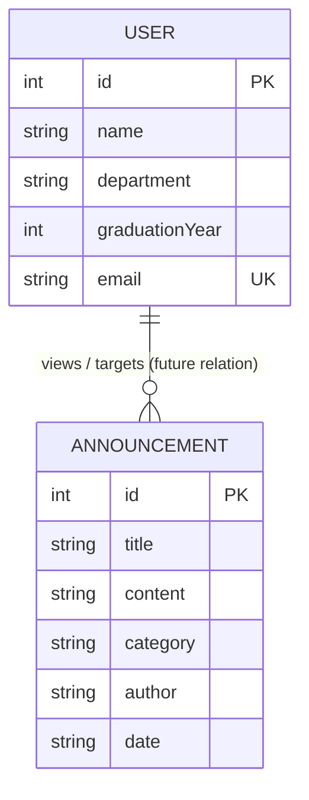
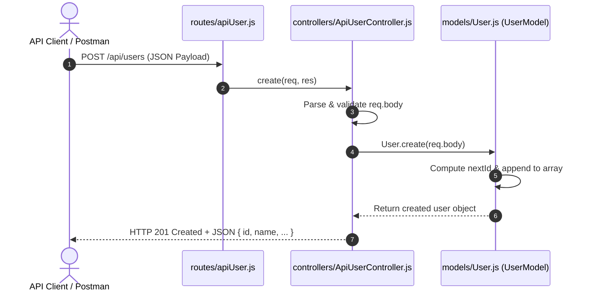
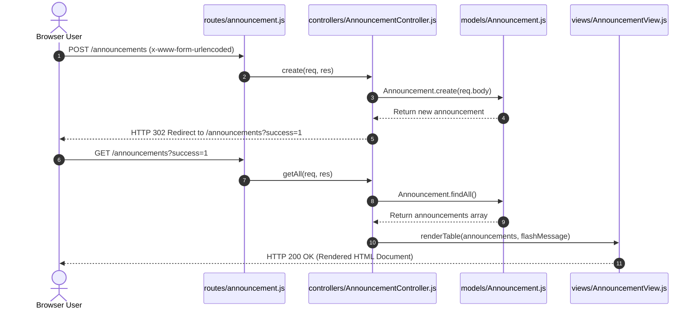

# 📊 Data Design Documentation (DDD)
> **Alumni Tracking System**  
> *Version:* 1.0.0  
> *Scope:* Data Architecture, Domain Models, In-Memory Storage, and Relational Database Transition Blueprint  
> *Target Audience:* Software Engineers, Architects, Course Evaluators, and Autonomous AI Agents  
> 🔗 **System Overview & MVC Manual:** [README.md](./README.md)

---

## 📑 Table of Contents
1. [Overview & Architectural Context](#1-overview--architectural-context)
2. [Domain Entities & Information Schema](#2-domain-entities--information-schema)
   - [User (Alumni) Entity](#21-user-alumni-entity)
   - [Announcement Entity](#22-announcement-entity)
   - [Entity-Relationship Diagram (ERD)](#23-entity-relationship-diagram-erd)
3. [Current Storage Implementation (In-Memory Store)](#3-current-storage-implementation-in-memory-store)
   - [Implementation Details](#31-implementation-details)
   - [Concurrency & Data Volatility Analysis ("The Forgetting Test")](#32-concurrency--data-volatility-analysis-the-forgetting-test)
4. [Model Interface & CRUD Operations Contract](#4-model-interface--crud-operations-contract)
   - [UserModel CRUD Interface](#41-usermodel-crud-interface)
   - [AnnouncementModel CRUD Interface](#42-announcementmodel-crud-interface)
5. [Data Flow & Lifecycle across the MVC Architecture](#5-data-flow--lifecycle-across-the-mvc-architecture)
   - [RESTful JSON API Data Flow](#51-restful-json-api-data-flow)
   - [Web Interface Form Submission Data Flow](#52-web-interface-form-submission-data-flow)
6. [Relational Database (PostgreSQL) Transition Blueprint](#6-relational-database-postgresql-transition-blueprint)
   - [PostgreSQL DDL Schemas](#61-postgresql-ddl-schemas)
   - [Constraints & Indexing Strategy](#62-constraints--indexing-strategy)
   - [Docker Compose PostgreSQL Service Configuration](#63-docker-compose-postgresql-service-configuration)
7. [Validation, Sanitization & Data Integrity Rules](#7-validation-sanitization--data-integrity-rules)
8. [AI Agent Quick Reference & Query Matrix](#8-ai-agent-quick-reference--query-matrix)

---

## 1. Overview & Architectural Context

The **Alumni Tracking System** is built on a clean **Model-View-Controller (MVC)** pattern. Within this architecture, the **Model Layer** ([`models/User.js`](file:///Users/hakanural06/alumni/models/User.js) and [`models/Announcement.js`](file:///Users/hakanural06/alumni/models/Announcement.js)) encapsulates all domain knowledge, validation, entity definitions, and data mutations.

### Key Design Principles:
- **Decoupled Persistence:** Business logic inside Controllers communicates strictly with Model class methods (`findAll`, `findById`, `create`, `update`, `delete`). Controllers remain agnostic to whether data originates from local process memory, a mock store, or a relational database (PostgreSQL).
- **Single Source of Truth:** Singleton instances of models are exported across the application, guaranteeing consistent state across both Web views and RESTful API endpoints during runtime.
- **Machine Readability:** This document specifies schema types, validation bounds, method contracts, and lifecycle behavior to enable autonomous AI agents to reason about, test, and refactor the data layer without breaking existing behavior.

---

## 2. Domain Entities & Information Schema

The system manages two core domain entities: **User (Alumni)** and **Announcement**.

### 2.1 User (Alumni) Entity

Represents an individual graduate of the institution.

| Attribute | Data Type | Constraint | Default Value | Description |
| :--- | :--- | :--- | :--- | :--- |
| `id` | `Integer` | Primary Key, Auto-increment, Unique | Dynamic (`max(id) + 1`) | Unique identifier for the alumni member. |
| `name` | `String` | Required, Min 1, Max 100 chars | `'Yeni Mezun'` | Full name of the alumni member. |
| `department` | `String` | Required, Enum / Standard string | `'Computer Engineering'` | Academic department from which the user graduated. |
| `graduationYear` | `Integer` | Required, Range: 1900–2100 | `2024` | Calendar year of graduation. Cast to `Number`. |
| `email` | `String` | Required, Email format | `[name]@alumni.edu` (slugified) | Primary email address for contact and notifications. |

#### JSON Representation
```json
{
  "id": 1,
  "name": "Hakan Ural",
  "department": "Computer Engineering",
  "graduationYear": 2024,
  "email": "hakan@alumni.edu"
}
```

---

### 2.2 Announcement Entity

Represents institutional notices, alumni homecoming invitations, career opportunities, and academic grants.

| Attribute | Data Type | Constraint | Default Value | Description |
| :--- | :--- | :--- | :--- | :--- |
| `id` | `Integer` | Primary Key, Auto-increment, Unique | Dynamic (`max(id) + 1`) | Unique identifier for the announcement. |
| `title` | `String` | Required, Min 3, Max 200 chars | `'New Announcement'` | Headline / title of the posting. |
| `content` | `String` | Optional / Text | `""` | Detailed description or body of the notice. |
| `category` | `String` | Required, Categorical | `'General'` | Category tag: `Event`, `Career`, `Academic`, `General`. |
| `author` | `String` | Required, Min 2 chars | `'Alumni Office'` | Publishing entity, office, or individual. |
| `date` | `String` | ISO 8601 Date format (`YYYY-MM-DD`) | Today (`new Date().toISOString().split('T')[0]`) | Effective publication or event date. |

#### JSON Representation
```json
{
  "id": 1,
  "title": "Annual Alumni Homecoming 2026",
  "content": "Join us on campus for keynote speeches, networking cocktails, and department visits.",
  "category": "Event",
  "author": "Alumni Office",
  "date": "2026-10-15"
}
```

---

### 2.3 Entity-Relationship Diagram (ERD)



> [!NOTE]
> Currently, `User` and `Announcement` operate as independent root aggregates in the in-memory store. When transitioning to a relational database, an optional foreign key (`author_id` referencing `users(id)`) can link announcements to verified alumni or admin users.

---

## 3. Storage Implementation & Database Connection Architecture

### 3.1 PostgreSQL Database Connection (`models/db.js`)
The Model Layer connects to PostgreSQL via a dedicated connection pooling module:
- **Source Code Locations:** [`models/db.js`](file:///Users/hakanural06/alumni/models/db.js), [`models/User.js`](file:///Users/hakanural06/alumni/models/User.js), and [`models/Announcement.js`](file:///Users/hakanural06/alumni/models/Announcement.js).
- **Storage Mechanism:** Relational persistence in PostgreSQL 16 (`users` and `announcements` tables) mounted via Docker volume `pgdata`.
- **Connection Pool:** `pg.Pool` with connection pooling, parameterized queries (`$1, $2, ...`) for SQL injection prevention, idle timeout management, and `allowExitOnIdle: true` for clean event-loop lifecycle.
- **Graceful Fallback:** If the database connection is unreachable or during isolated offline tests, models gracefully fall back to in-memory state without crashing.

### 3.2 Resolution of Data Volatility ("The Forgetting Test" Resolved)

```
[Container / Process Lifecycle with PostgreSQL Persistence]
┌──────────────────────────────────────────────┐
│ Express Web Application Container            │
│  - Controllers invoke async Model CRUD       │
└──────────────────────────────────────────────┘
                       │
             TCP / Pool Connection (5432)
                       ▼
┌──────────────────────────────────────────────┐
│ PostgreSQL Container (db)                    │
│  - Tables: users, announcements, migrations  │
└──────────────────────────────────────────────┘
                       │
       docker compose down / process kill
                       ▼
┌──────────────────────────────────────────────┐
│ Named Docker Volume: pgdata                  │
│  * ALL DATA PERSISTED! NO AMNESIA!           │
└──────────────────────────────────────────────┘
```

---

## 4. Model Interface & CRUD Operations Contract

Both models implement a uniform, asynchronous CRUD contract returning Promises resolving to JavaScript Objects or Arrays.

### 4.1 UserModel CRUD Interface

```typescript
interface UserModelContract {
  create(userData: {
    name?: string;
    department?: string;
    graduationYear?: number | string;
    email?: string;
  }): Promise<User>;

  findAll(): Promise<User[]>;

  findById(id: number | string): Promise<User | null>;

  update(
    id: number | string,
    updateData: {
      name?: string;
      department?: string;
      graduationYear?: number | string;
      email?: string;
    }
  ): Promise<User | null>;

  delete(id: number | string): Promise<User | null>;
}
```

- **`create(userData)`:** Executes `INSERT INTO users (...) VALUES (...) RETURNING ...` with `ON CONFLICT (email)` update safety, returns the newly created or updated record.
- **`findAll()`:** Executes `SELECT id, name, department, graduation_year AS "graduationYear", email, created_at, updated_at FROM users ORDER BY id ASC`.
- **`findById(id)`:** Executes parameterized `SELECT ... FROM users WHERE id = $1`.
- **`update(id, updateData)`:** Executes parameterized `UPDATE users SET ... WHERE id = $... RETURNING ...`.
- **`delete(id)`:** Executes `DELETE FROM users WHERE id = $1 RETURNING ...`.

### 4.2 AnnouncementModel CRUD Interface

```typescript
interface AnnouncementModelContract {
  create(data: {
    title?: string;
    content?: string;
    category?: string;
    author?: string;
    date?: string;
  }): Promise<Announcement>;

  findAll(): Promise<Announcement[]>;

  findById(id: number | string): Promise<Announcement | null>;

  update(
    id: number | string,
    updateData: {
      title?: string;
      content?: string;
      category?: string;
      author?: string;
      date?: string;
    }
  ): Promise<Announcement | null>;

  delete(id: number | string): Promise<Announcement | null>;
}
```

---

## 5. Data Flow & Lifecycle across the MVC Architecture

### 5.1 RESTful JSON API Data Flow



### 5.2 Web Interface Form Submission Data Flow



---

## 6. Relational Database (PostgreSQL) Transition Blueprint

To resolve the data amnesia demonstrated in the "Forgetting Test", the data layer is architected for seamless migration to PostgreSQL.

### 6.1 PostgreSQL DDL Schemas

```sql
-- Enable UUID extension if UUID identifiers are desired in the future
CREATE EXTENSION IF NOT EXISTS "uuid-ossp";

-- Table: users (Alumni Records)
CREATE TABLE IF NOT EXISTS users (
    id SERIAL PRIMARY KEY,
    name VARCHAR(120) NOT NULL,
    department VARCHAR(150) NOT NULL DEFAULT 'Computer Engineering',
    graduation_year SMALLINT NOT NULL CHECK (graduation_year >= 1900 AND graduation_year <= 2100),
    email VARCHAR(255) NOT NULL UNIQUE,
    created_at TIMESTAMP WITH TIME ZONE DEFAULT CURRENT_TIMESTAMP,
    updated_at TIMESTAMP WITH TIME ZONE DEFAULT CURRENT_TIMESTAMP
);

-- Table: announcements (Bulletins & Notices)
CREATE TABLE IF NOT EXISTS announcements (
    id SERIAL PRIMARY KEY,
    title VARCHAR(200) NOT NULL,
    content TEXT DEFAULT '',
    category VARCHAR(50) NOT NULL DEFAULT 'General',
    author VARCHAR(100) NOT NULL DEFAULT 'Alumni Office',
    publication_date DATE NOT NULL DEFAULT CURRENT_DATE,
    created_at TIMESTAMP WITH TIME ZONE DEFAULT CURRENT_TIMESTAMP,
    updated_at TIMESTAMP WITH TIME ZONE DEFAULT CURRENT_TIMESTAMP
);

-- Optional trigger function to automatically update updated_at timestamp
CREATE OR REPLACE FUNCTION update_timestamp()
RETURNS TRIGGER AS $$
BEGIN
    NEW.updated_at = CURRENT_TIMESTAMP;
    RETURN NEW;
END;
$$ LANGUAGE plpgsql;

CREATE TRIGGER trg_users_update
    BEFORE UPDATE ON users
    FOR EACH ROW
    EXECUTE FUNCTION update_timestamp();

CREATE TRIGGER trg_announcements_update
    BEFORE UPDATE ON announcements
    FOR EACH ROW
    EXECUTE FUNCTION update_timestamp();
```

### 6.2 Constraints & Indexing Strategy

| Table | Index Name | Column(s) | Type | Purpose |
| :--- | :--- | :--- | :--- | :--- |
| `users` | `idx_users_email` | `email` | `BTREE UNIQUE` | Fast lookup during login/search; enforces email uniqueness. |
| `users` | `idx_users_dept_year` | `(department, graduation_year)` | `BTREE` | Accelerates directory filtering by department and graduating class. |
| `announcements` | `idx_announcements_date` | `publication_date DESC` | `BTREE` | Fast retrieval of latest announcements on the home/feed view. |
| `announcements` | `idx_announcements_cat` | `category` | `BTREE` | Efficient filtering by event/career category tags. |

### 6.3 Database Migrations Architecture (`migrations/`)

The application adopts an idempotent SQL migration strategy with automatic execution capabilities:

```
migrations/
├── 001_create_tables.sql  # DDL: creates users, announcements, indexes, triggers
└── 002_seed_data.sql      # DML: seeds initial 3 users and 3 announcements
```

#### Migration Lifecycle & Execution Methods:
1. **Docker Automatic Execution (`/docker-entrypoint-initdb.d`):**
   When PostgreSQL container starts for the first time, all `.sql` files mounted in `/docker-entrypoint-initdb.d` are automatically executed in alphabetical order.
2. **Node.js Migration Runner (`scripts/migrate.js`):**
   Can be run manually via `npm run migrate` anytime against local or remote PostgreSQL. Tracks applied scripts in the `schema_migrations` table to guarantee idempotency.

```sql
-- Migration tracking table
CREATE TABLE IF NOT EXISTS schema_migrations (
    id SERIAL PRIMARY KEY,
    name VARCHAR(255) NOT NULL UNIQUE,
    applied_at TIMESTAMP WITH TIME ZONE DEFAULT CURRENT_TIMESTAMP
);
```

### 6.4 Docker Compose PostgreSQL Service Configuration

The updated `docker-compose.yml` mounts the persistent volume (`pgdata`) and the `migrations/` directory for automatic startup initialization:

```yaml
services:
  web:
    build: .
    ports:
      - "3000:3000"
    environment:
      - PORT=3000
      - DATABASE_URL=postgres://alumni_user:alumni_password@db:5432/alumni_db
    depends_on:
      - db

  db:
    image: postgres:16-alpine
    restart: always
    environment:
      POSTGRES_USER: alumni_user
      POSTGRES_PASSWORD: alumni_password
      POSTGRES_DB: alumni_db
    ports:
      - "5432:5432"
    volumes:
      - pgdata:/var/lib/postgresql/data
      - ./migrations:/docker-entrypoint-initdb.d:ro

volumes:
  pgdata:
```

### 6.5 Data Factories & Database Seeding Architecture (`factories/` & `scripts/seed.js`)

To facilitate reproducible testing, automated benchmarks, and reliable data population during development and CI/CD, the system implements the **Factory Pattern** and an automated **Database Seeder** tool:

```
factories/
├── UserFactory.js          # Generates single / bulk valid alumni records
├── AnnouncementFactory.js  # Generates single / bulk valid announcement records
└── index.js                # Aggregates and exports all factories
```

#### Factory Contracts:
- **`UserFactory.create(overrides = {})`**: Generates a mock `User` object with valid name, department, graduation year, and unique email.
- **`UserFactory.createMany(count, overrides = {})`**: Generates `count` unique user objects.
- **`UserFactory.createInDb(client, overrides = {})`**: Persists the generated user record directly into PostgreSQL with `ON CONFLICT (email)` safety.
- **`AnnouncementFactory.create(overrides = {})`**: Generates a mock `Announcement` object with category, content, author, and date.
- **`AnnouncementFactory.createMany(count, overrides = {})`**: Generates `count` unique announcement objects.
- **`AnnouncementFactory.createInDb(client, overrides = {})`**: Persists the generated announcement directly into PostgreSQL.

#### Database Seeding Lifecycle (`npm run seed` / `scripts/seed.js`):
1. **Connect:** Establishes connection to PostgreSQL using `DATABASE_URL`.
2. **Seed Users:** Invokes `UserFactory.createInDb()` in a loop to populate 5 realistic alumni records.
3. **Seed Announcements:** Invokes `AnnouncementFactory.createInDb()` to populate 5 varied announcements across categories (`Event`, `Career`, `Academic`, `General`).
4. **Synchronize In-Memory Stores:** Synchronizes `UserModel.users` and `AnnouncementModel.announcements` if running within an active Node process.
5. **Idempotency:** Safe to run repeatedly; duplicate emails are handled gracefully via `ON CONFLICT` clauses.

---

## 7. Validation, Sanitization & Data Integrity Rules

| Field | Validation Rule | Error Response Code | Sanitization Handling |
| :--- | :--- | :--- | :--- |
| `user.name` | Required, string, trimmed length >= 1 | `400 Bad Request` | Trim whitespace, escape `<>&"` in HTML views. |
| `user.email` | RFC 5322 regex validation, unique | `400 Bad Request` | Lowercase conversion (`trim().toLowerCase()`). |
| `user.graduationYear` | Integer, 1900 <= year <= 2100 | `400 Bad Request` | Coerce via `Number(val)`. |
| `announcement.title` | Required, string, trimmed length >= 3 | `400 Bad Request` | Trim whitespace, strip malicious HTML tags. |
| `announcement.category`| Must match: `Event`, `Career`, `Academic`, `General` | `400 Bad Request` | Default to `'General'` if omitted. |
| `announcement.date` | ISO Date format `YYYY-MM-DD` | `400 Bad Request` | Default to `new Date().toISOString().split('T')[0]`. |

---

## 8. AI Agent Quick Reference & Query Matrix

This matrix provides AI agents with instant mappings between business actions, endpoints, controller methods, and model contracts:

| Target Resource | Action | Method | Route | Controller Call | Model Invocation |
| :--- | :--- | :--- | :--- | :--- | :--- |
| **User (API)** | List All | `GET` | `/api/users` | `ApiUserController.getAll` | `User.findAll()` |
| **User (API)** | Get One | `GET` | `/api/users/:id` | `ApiUserController.getById` | `User.findById(id)` |
| **User (API)** | Create | `POST` | `/api/users` | `ApiUserController.create` | `User.create(body)` |
| **User (API)** | Update | `PUT` / `PATCH` | `/api/users/:id` | `ApiUserController.update` | `User.update(id, body)` |
| **User (API)** | Delete | `DELETE` | `/api/users/:id` | `ApiUserController.delete` | `User.delete(id)` |
| **User (Web)** | Directory View | `GET` | `/users` | `UserController.getAll` | `User.findAll()` |
| **User (Web)** | Detail Card | `GET` | `/users/:id` | `UserController.getById` | `User.findById(id)` |
| **User (Web)** | Form Create | `POST` | `/users` | `UserController.create` | `User.create(body)` |
| **User (Web)** | Form Update | `POST` | `/users/:id/edit` | `UserController.update` | `User.update(id, body)` |
| **User (Web)** | Form Delete | `POST` | `/users/:id/delete`| `UserController.delete` | `User.delete(id)` |
| **Announcement (API)** | List All | `GET` | `/api/announcements` | `ApiAnnouncementController.getAll` | `Announcement.findAll()` |
| **Announcement (API)** | Get One | `GET` | `/api/announcements/:id` | `ApiAnnouncementController.getById` | `Announcement.findById(id)` |
| **Announcement (API)** | Create | `POST` | `/api/announcements` | `ApiAnnouncementController.create` | `Announcement.create(body)` |
| **Announcement (API)** | Update | `PUT` / `PATCH` | `/api/announcements/:id`| `ApiAnnouncementController.update` | `Announcement.update(id, body)` |
| **Announcement (API)** | Delete | `DELETE` | `/api/announcements/:id`| `ApiAnnouncementController.delete` | `Announcement.delete(id)` |
| **Announcement (Web)** | Dashboard View | `GET` | `/announcements` | `AnnouncementController.getAll` | `Announcement.findAll()` |
| **Announcement (Web)** | Detail Card | `GET` | `/announcements/:id` | `AnnouncementController.getById` | `Announcement.findById(id)` |
| **Announcement (Web)** | Form Create | `POST` | `/announcements` | `AnnouncementController.create` | `Announcement.create(body)` |
| **Announcement (Web)** | Form Update | `POST` | `/announcements/:id/edit` | `AnnouncementController.update` | `Announcement.update(id, body)` |
| **Announcement (Web)** | Form Delete | `POST` | `/announcements/:id/delete`| `AnnouncementController.delete` | `Announcement.delete(id)` |

---
*Document automatically maintained and indexed for AI agents and developer tooling.*
