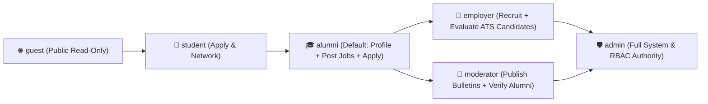
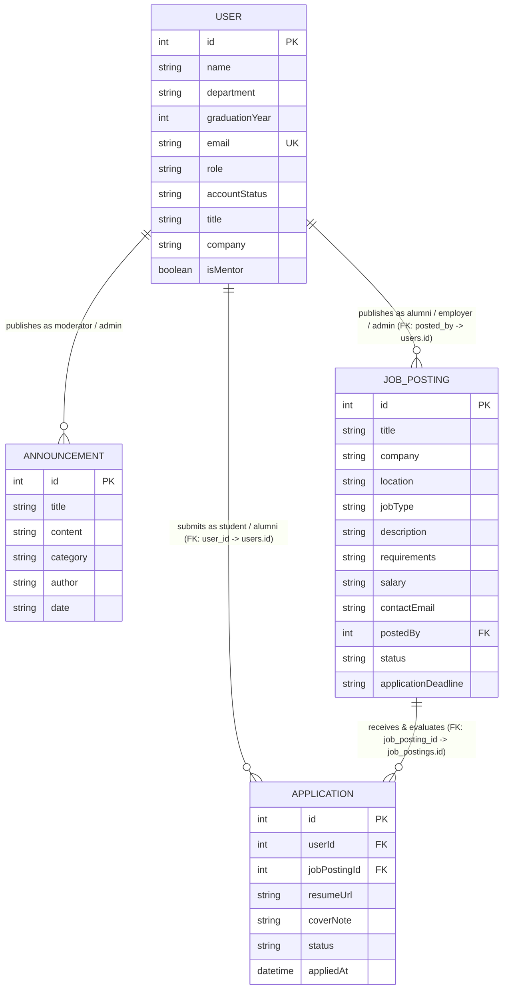
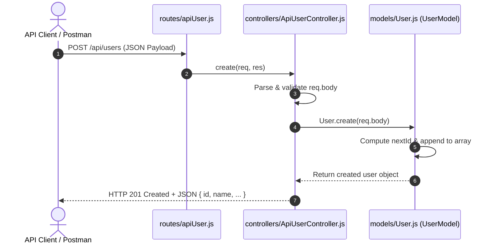
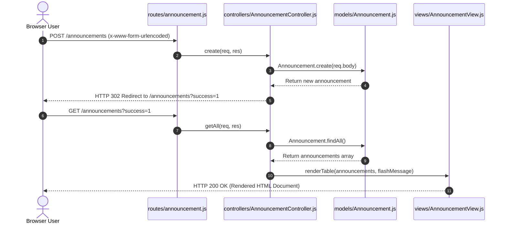
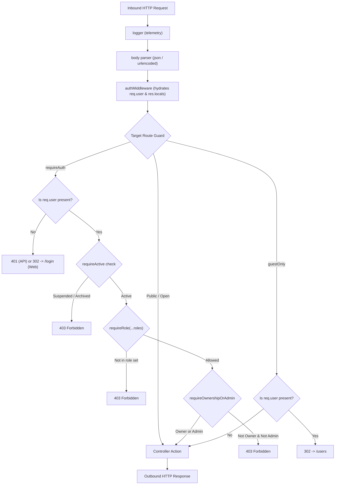

# 📊 Data Design Documentation (DDD)
> **Alumni Tracking System — Istanbul University (*İstanbul Üniversitesi*)**  
> *Version:* 2.1.0  
> *Scope:* Data Architecture, Domain Models, User Roles & RBAC Matrix, Validation Rules, Observability/Error Contracts, In-Memory Storage, and Relational Database Transition Blueprint  
> *Target Audience:* Software Engineers, Architects, Course Evaluators, and Autonomous AI Agents  
> 🔗 **System Overview & MVC Manual:** [README.md](./README.md) &bull; **Brand & Vision Guide:** [brand.md](./brand.md) &bull; **Design System:** [design.md](./design.md)

---

## 📑 Table of Contents
1. [Overview & Architectural Context](#1-overview--architectural-context)
2. [Domain Entities & Information Schema](#2-domain-entities--information-schema)
   - [User (Alumni) Entity & Role Attributes](#21-user-alumni-entity--role-attributes)
   - [User Roles, Personas & Role-Based Access Control (RBAC) Matrix](#22-user-roles-personas--role-based-access-control-rbac-matrix)
   - [Announcement Entity](#23-announcement-entity)
   - [Job Posting Entity](#24-job-posting-entity)
   - [Application Action Entity (User-Job Action Table)](#25-application-action-entity-user-job-action-table)
   - [Entity-Relationship Diagram (ERD)](#26-entity-relationship-diagram-erd)
3. [Storage Implementation & Database Connection Architecture](#3-storage-implementation--database-connection-architecture)
   - [PostgreSQL Database Connection (`models/db.js`)](#31-postgresql-database-connection-modelsdbjs)
   - [Resolution of Data Volatility ("The Forgetting Test" Resolved)](#32-resolution-of-data-volatility-the-forgetting-test-resolved)
4. [Model Interface & CRUD Operations Contract](#4-model-interface--crud-operations-contract)
   - [UserModel CRUD Interface](#41-usermodel-crud-interface)
   - [AnnouncementModel CRUD Interface](#42-announcementmodel-crud-interface)
   - [JobPostingModel CRUD Interface](#43-jobpostingmodel-crud-interface)
   - [ApplicationModel CRUD Interface](#44-applicationmodel-crud-interface)
5. [Data Flow & Lifecycle across the MVC Architecture](#5-data-flow--lifecycle-across-the-mvc-architecture)
   - [RESTful JSON API Data Flow](#51-restful-json-api-data-flow)
   - [Web Interface Form Submission Data Flow](#52-web-interface-form-submission-data-flow)
6. [Relational Database (PostgreSQL) Transition Blueprint](#6-relational-database-postgresql-transition-blueprint)
   - [PostgreSQL DDL Schemas](#61-postgresql-ddl-schemas)
   - [Constraints & Indexing Strategy](#62-constraints--indexing-strategy)
   - [Database Migrations Architecture (`migrations/`)](#63-database-migrations-architecture-migrations)
   - [Docker Compose PostgreSQL Service Configuration](#64-docker-compose-postgresql-service-configuration)
   - [Data Factories & Database Seeding Architecture (`factories/` & `scripts/seed.js`)](#65-data-factories--database-seeding-architecture-factories--scriptsseedjs)
7. [Validation, Sanitization & Data Integrity Rules](#7-validation-sanitization--data-integrity-rules)
   - [Entity Field Validation & Sanitization Matrix](#71-entity-field-validation--sanitization-matrix)
   - [Domain Business Rules & Lifecycle Policies](#72-domain-business-rules--lifecycle-policies)
   - [Security, Input Normalization & Error Contract](#73-security-input-normalization--error-contract)
   - [Middleware Observability and Guardian Error Contract](#74-middleware-observability-and-guardian-error-contract)
   - [Authentication, Session Lifecycle & Credential Security Contract](#75-authentication-session-lifecycle--credential-security-contract)
   - [Administration Console & Data Manipulation Governance](#76-administration-console--data-manipulation-governance)
   - [Dynamic Role-Based Navigation & Menu System](#77-dynamic-role-based-navigation--menu-system)
   - [Dedicated User Profile & Personal Workspace](#78-dedicated-user-profile--personal-workspace)
8. [AI Agent Quick Reference & Query Matrix](#8-ai-agent-quick-reference--query-matrix)

---

## 1. Overview & Architectural Context

The **Alumni Tracking System** is built on a clean **Model-View-Controller (MVC)** pattern. Within this architecture, the **Model Layer** ([`models/User.js`](file:///Users/hakanural06/alumni/models/User.js), [`models/Announcement.js`](file:///Users/hakanural06/alumni/models/Announcement.js), [`models/JobPosting.js`](file:///Users/hakanural06/alumni/models/JobPosting.js), and [`models/Application.js`](file:///Users/hakanural06/alumni/models/Application.js)) encapsulates all domain knowledge, validation, entity definitions, and data mutations.

### Key Design Principles:
- **Decoupled Persistence:** Business logic inside Controllers communicates strictly with Model class methods (`findAll`, `findById`, `create`, `update`, `delete`). Controllers remain agnostic to whether data originates from local process memory, a mock store, or a relational database (PostgreSQL).
- **Single Source of Truth:** Singleton instances of models are exported across the application, guaranteeing consistent state across both Web views and RESTful API endpoints during runtime.
- **Machine Readability:** This document specifies schema types, validation bounds, method contracts, and lifecycle behavior to enable autonomous AI agents to reason about, test, and refactor the data layer without breaking existing behavior.

---

## 2. Domain Entities & Information Schema

The system manages four core domain entities and action tables: **User (Alumni)**, **Announcement**, **Job Posting**, and **Application** (Action table connecting Users and Job Postings).

### 2.1 User (Alumni) Entity & Role Attributes

Represents an individual member or stakeholder of the **Istanbul University** ecosystem—including verified graduates (`alumni`), current students (`student`), corporate/alumni recruiters (`employer`), faculty/association coordinators (`moderator`), and system administrators (`admin`).

| Attribute | Data Type | Constraint | Default Value | Description |
| :--- | :--- | :--- | :--- | :--- |
| `id` | `Integer` | Primary Key, Auto-increment, Unique | Dynamic (`max(id) + 1`) | Unique identifier for the user / alumni member. |
| `name` | `String` | Required, Min 2, Max 120 chars (non-whitespace) | `'Yeni Mezun'` | Full name of the user. |
| `department` | `String` | Required, Min 2, Max 150 chars (non-whitespace) | `'Computer Engineering'` | Academic faculty or department (e.g., `'Computer Engineering'`, `'Law'`, `'Medicine'`, `'Economics'`). |
| `graduationYear` | `Integer` | Required, Integer, Range: 1900–2100 | `2024` | Calendar year of graduation (or expected graduation for `student`). Cast to `Number`. |
| `email` | `String` | Required, Unique (case-insensitive), RFC 5322 Email format, Max 255 chars | `[name]@alumni.edu` (slugified) | Primary email address for identity, contact, and notifications (stored trimmed & lowercased). |
| `role` | `String` | Required, Enum: `'student'`, `'alumni'`, `'employer'`, `'moderator'`, `'admin'` | `'alumni'` | Canonical system role governing RBAC permissions across directory, announcements, jobs, and ATS. |
| `accountStatus` | `String` | Required, Enum: `'active'`, `'pending_verification'`, `'suspended'`, `'archived'` | `'active'` | Operational and verification state of the user account. |
| `title` | `String` | Optional, Max 150 chars | `null` | Current professional headline or academic title (e.g., `'Senior Backend Engineer'`, `'Professor'`). |
| `company` | `String` | Optional, Max 150 chars | `null` | Current employer, institution, or organization affiliation. |
| `isMentor` | `Boolean` | Optional, Boolean | `false` | Flag indicating whether the user is opted-in to mentor students and recent graduates. |
| `createdAt` | `String` | ISO 8601 Timestamp | Current Timestamp | Record creation timestamp. |
| `updatedAt` | `String` | ISO 8601 Timestamp | Current Timestamp | Record last update timestamp. |

#### JSON Representation (Core & Role-Enriched)
```json
{
  "id": 1,
  "name": "Hakan Ural",
  "department": "Computer Engineering",
  "graduationYear": 2024,
  "email": "hakan@alumni.edu",
  "role": "alumni",
  "accountStatus": "active",
  "title": "Software Engineer",
  "company": "TechCorp",
  "isMentor": true
}
```

---

### 2.2 User Roles, Personas & Role-Based Access Control (RBAC) Matrix

The platform enforces a structured **Role-Based Access Control (RBAC)** model combined with **Resource Ownership** (`user.id === resource.ownerId`) so every stakeholder in the Istanbul University community operates within clearly defined domain boundaries.

#### 2.2.1 Canonical System Roles

| Role Identifier | Display Title (TR / EN) | Target Stakeholder | Core Responsibilities & Capabilities |
| :--- | :--- | :--- | :--- |
| **`guest`** *(Implicit)* | Ziyaretçi / Unauthenticated Visitor | Prospective students, external visitors, health probes | Read-only browsing of the public portal home (`/`), institutional heritage (`/about`), public announcements, active job listings, and health checks (`/api/health`). Cannot mutate state or view private applicant dossiers. |
| **`student`** | Mevcut Öğrenci / Current Student | Enrolled undergraduate & graduate students (`graduationYear >= CURRENT_YEAR`) | Browse the Alumni Directory for mentors, read campus announcements, apply to `'Active'` internships and entry-level job postings (`POST /applications`), and track or withdraw own applications (`/users/:userId/applications`). Cannot publish job postings or official announcements. |
| **`alumni`** *(Default)* | Mezun / Verified Graduate | Graduated Istanbul University alumni across all faculties | Maintain own alumni profile, browse directory, publish career opportunities (`POST /jobs`, `/api/users/:userId/jobs`), review candidate applications submitted to their own job postings (`jobPosting.postedBy === user.id`), apply to other alumni's job postings (`userId !== postedBy`), and opt into mentorship (`isMentor = true`). |
| **`employer`** | İşveren & Kurumsal Partner / Partner Recruiter | Corporate hiring managers, HR partners, and alumni company founders | Create, manage, and close company job postings (`Draft -> Active -> Closed`), inspect candidate submissions for owned job postings (`/jobs/:jobId/applications`), download candidate resumes, and update evaluation statuses (`Submitted -> Under Review -> Interviewing -> Accepted | Rejected`). |
| **`moderator`** | Bölüm & Dernek Koordinatörü / Faculty & Alumni Coordinator | Department chairs, Career Center officers, Alumni Association staff | Publish, edit, and delete official university announcements (`Event`, `Career`, `Academic`, `General`), verify newly registered alumni (`pending_verification -> active`), and moderate or close non-compliant job postings across the portal. |
| **`admin`** | Sistem Yöneticisi / System Administrator | Rectorate IT, Platform Architects, Superusers | Full unrestricted CRUD and administrative authority over all `users`, `announcements`, `job_postings`, `applications`, role assignments (`role`, `accountStatus`), database migrations/seeding, and Guardian error telemetry (`logs/error.logs`). |

#### 2.2.2 Role Hierarchy & Privilege Escalation Flow



#### 2.2.3 Role-Based Access Control (RBAC) Permission Matrix

Legend:
- **`ALL`**: Full access to any record across the system.
- **`OWN`**: Permitted only when the authenticated user owns the record (`user.id === targetUser.id`, `user.id === jobPosting.postedBy`, or `user.id === application.userId`).
- **`JOB_OWNER`**: Permitted when the user is the publisher of the parent `JobPosting` (`user.id === jobPosting.postedBy`).
- **`READ_PUBLIC`**: Read-only access to active/publicly visible records.
- **`DENIED`**: Operation forbidden (`401 Unauthorized` for `guest`, `403 Forbidden` for authenticated roles).

| Domain Resource & Action | Endpoint / Operation | `guest` | `student` | `alumni` | `employer` | `moderator` | `admin` |
| :--- | :--- | :---: | :---: | :---: | :---: | :---: | :---: |
| **Portal & Heritage** | `GET /`, `GET /about`, `GET /api/health` | `READ_PUBLIC` | `READ_PUBLIC` | `READ_PUBLIC` | `READ_PUBLIC` | `READ_PUBLIC` | `ALL` |
| **User Directory — Read** | `GET /users`, `GET /api/users`, `GET /users/:id` | `READ_PUBLIC` | `READ_PUBLIC` | `READ_PUBLIC` | `READ_PUBLIC` | `ALL` | `ALL` |
| **User Profile — Register** | `POST /users`, `POST /api/users` | Self-Register | `OWN` | `OWN` | `OWN` | `ALL` | `ALL` |
| **User Profile — Update** | `PUT/PATCH /api/users/:id`, `POST /users/:id/edit` | `DENIED` | `OWN` | `OWN` | `OWN` | `OWN` + Verify | `ALL` |
| **User Role / Status Mutation**| Change `user.role` or `user.accountStatus` | `DENIED` | `DENIED` | `DENIED` | `DENIED` | Verify Status Only | `ALL` |
| **User Profile — Delete** | `DELETE /api/users/:id`, `POST /users/:id/delete` | `DENIED` | `OWN` | `OWN` | `OWN` | `DENIED` | `ALL` |
| **Announcements — Read** | `GET /announcements`, `GET /api/announcements` | `READ_PUBLIC` | `READ_PUBLIC` | `READ_PUBLIC` | `READ_PUBLIC` | `ALL` | `ALL` |
| **Announcements — Write** | `POST/PUT/PATCH/DELETE /api/announcements` | `DENIED` | `DENIED` | `DENIED` | `DENIED` | `ALL` | `ALL` |
| **Job Postings — Read** | `GET /jobs`, `GET /api/jobs`, `GET /jobs/:id` | `Active` Only | `Active` Only | `Active` + `OWN` | `Active` + `OWN` | `ALL` | `ALL` |
| **Job Postings — Create** | `POST /jobs`, `POST /api/jobs`, `POST /api/users/:userId/jobs`| `DENIED` | `DENIED` | `OWN` (`postedBy`) | `OWN` (`postedBy`) | `ALL` | `ALL` |
| **Job Postings — Update** | `PUT/PATCH /api/jobs/:id`, `POST /jobs/:id/edit` | `DENIED` | `DENIED` | `OWN` (`postedBy`) | `OWN` (`postedBy`) | `ALL` (Moderate) | `ALL` |
| **Job Postings — Delete** | `DELETE /api/jobs/:id`, `POST /jobs/:id/delete` | `DENIED` | `DENIED` | `OWN` (`postedBy`) | `OWN` (`postedBy`) | `ALL` (Moderate) | `ALL` |
| **Applications — Submit** | `POST /applications`, `POST /api/applications` | `DENIED` | `OWN` (`userId`) | `OWN` (`userId != postedBy`) | `DENIED` | `DENIED` | `ALL` |
| **Applications — View List** | `GET /applications`, `GET /users/:userId/applications` | `DENIED` | `OWN` (`userId`) | `OWN` + `JOB_OWNER`| `JOB_OWNER` | `ALL` (Audit) | `ALL` |
| **Applications — View Candidates**| `GET /jobs/:jobId/applications` | `DENIED` | `DENIED` | `JOB_OWNER` | `JOB_OWNER` | `ALL` (Audit) | `ALL` |
| **Applications — Evaluate Status**| `PATCH /api/applications/:id`, `POST /applications/:id/status`| `DENIED` | Withdraw `OWN` | Withdraw `OWN` / Evaluate as `JOB_OWNER` | Evaluate as `JOB_OWNER` | `DENIED` | `ALL` |
| **Applications — Delete** | `DELETE /api/applications/:id` | `DENIED` | `OWN` | `OWN` | `DENIED` | `DENIED` | `ALL` |

---

### 2.3 Announcement Entity

Represents institutional notices, alumni homecoming invitations, career opportunities, and academic grants.

| Attribute | Data Type | Constraint | Default Value | Description |
| :--- | :--- | :--- | :--- | :--- |
| `id` | `Integer` | Primary Key, Auto-increment, Unique | Dynamic (`max(id) + 1`) | Unique identifier for the announcement. |
| `title` | `String` | Required, Min 3, Max 200 chars (non-whitespace) | `'New Announcement'` | Headline / title of the posting. |
| `content` | `String` | Optional / Text, Max 5000 chars | `""` | Detailed description or body of the notice (trimmed & sanitized). |
| `category` | `String` | Required, Enum: `Event`, `Career`, `Academic`, `General` | `'General'` | Category tag: `Event`, `Career`, `Academic`, `General`. |
| `author` | `String` | Required, Min 2, Max 100 chars (non-whitespace) | `'Alumni Office'` | Publishing entity, office, or individual. |
| `date` | `String` | Required, Valid ISO 8601 Date (`YYYY-MM-DD`) | Today (`new Date().toISOString().split('T')[0]`) | Effective publication or event date. |

#### JSON Representation
```json
{
  "id": 1,
  "title": "Annual Alumni Homecoming 2026",
  "content": "Join us on campus for keynote speeches, networking cocktails, and department visits.",
  "category": "Event",
  "author": "Alumni Office",
  "date": "2026-10-15"
}
```

---

### 2.4 Job Posting Entity

Represents career opportunities, internships, and professional roles shared within the alumni network by graduates, partner organizations, and university career coordinators.

| Attribute | Data Type | Constraint | Default Value | Description |
| :--- | :--- | :--- | :--- | :--- |
| `id` | `Integer` | Primary Key, Auto-increment, Unique | Dynamic (`max(id) + 1`) | Unique identifier for the job posting. |
| `title` | `String` | Required, Min 3, Max 120 chars (non-whitespace) | `'Software Engineer'` | Title or headline of the job opportunity. |
| `company` | `String` | Required, Min 2, Max 150 chars (non-whitespace) | `'Partner Company'` | Name of the hiring company or institution. |
| `location` | `String` | Required, Min 2, Max 150 chars (non-whitespace) | `'Remote'` | City / workplace location (e.g., `'Istanbul'`, `'Ankara / Hybrid'`, `'Remote'`). |
| `jobType` | `String` | Required, Enum: `Full-time`, `Part-time`, `Contract`, `Internship`, `Remote` | `'Full-time'` | Employment type classification. |
| `description` | `String` | Required when `status = 'Active'` (Optional for `'Draft'`), Min 20 when Active, Max 5000 chars | `""` | In-depth description of responsibilities and scope. |
| `requirements` | `String` | Optional / Text, Max 3000 chars | `""` | Required qualifications, skills, and experience criteria. |
| `salary` | `String` | Optional, Max 100 chars (non-empty if provided) | `null` | Disclosed compensation or range (e.g., `'$90,000 - $120,000'`). |
| `contactEmail` | `String` | Required, RFC 5322 Email format, Max 255 chars | `'careers@company.com'` | Contact or submission email for applications (stored trimmed & lowercased). |
| `postedBy` | `Integer` | Positive Integer FK referencing `users(id)`, Nullable (Mandatory on `/api/users/:userId/jobs`) | `null` | Identifier of the alumni member or administrator posting the role. |
| `status` | `String` | Required, Enum: `Active`, `Closed`, `Draft` | `'Active'` | Operational state of the job listing. |
| `applicationDeadline` | `String` | Optional, Valid ISO 8601 Date (`YYYY-MM-DD`); must be `>= CURRENT_DATE` when Active | `null` | Cutoff date for receiving applications. |
| `createdAt` | `String` | ISO 8601 Timestamp | Current Timestamp | Record creation timestamp. |
| `updatedAt` | `String` | ISO 8601 Timestamp | Current Timestamp | Record last update timestamp. |

#### JSON Representation
```json
{
  "id": 1,
  "title": "Senior Backend Engineer (Node.js / PostgreSQL)",
  "company": "TechCorp Innovations",
  "location": "Istanbul / Hybrid",
  "jobType": "Full-time",
  "description": "We are seeking a senior backend engineer to scale our distributed cloud services and database infrastructure.",
  "requirements": "3+ years Node.js, Express, PostgreSQL, Docker, and REST API design experience.",
  "salary": "₺85,000 - ₺110,000 / month",
  "contactEmail": "careers@techcorp.com",
  "postedBy": 1,
  "status": "Active",
  "applicationDeadline": "2026-12-31"
}
```

---

### 2.5 Application Action Entity (User-Job Action Table)

Represents the concrete action of an alumni member or student applying to a published job posting. Acts as an action/junction table governing the Many-to-Many relationship between `users` and `job_postings` with transactional status tracking.

| Attribute | Data Type | Constraint | Default Value | Description |
| :--- | :--- | :--- | :--- | :--- |
| `id` | `Integer` | Primary Key, Auto-increment, Unique | Dynamic (`max(id) + 1`) | Unique identifier for the application record. |
| `userId` / `user_id` | `Integer` | Foreign Key referencing `users(id)`, Cascade Delete | Required | ID of the alumni candidate submitting the application. |
| `jobPostingId` / `job_posting_id`| `Integer` | Foreign Key referencing `job_postings(id)`, Cascade Delete | Required | ID of the target job posting. |
| `resumeUrl` / `resume_url` | `String` | Optional, HTTP(S) URL or safe relative path, Max 500 chars | `null` | Link or storage location of candidate resume (reject unsafe schemes such as `javascript:`/`data:`). |
| `coverNote` / `cover_note` | `String` | Optional / Text, Max 2000 chars | `""` | Accompanying cover note, bio, or message (trimmed & XSS-sanitized). |
| `status` | `String` | Required, Enum: `Submitted`, `Pending`, `Under Review`, `Reviewed`, `Interviewing`, `Accepted`, `Rejected`, `Withdrawn` | `'Submitted'` | Lifecycle evaluation status of application. |
| `appliedAt` / `applied_at` | `String` | ISO 8601 Timestamp | Current Timestamp | Submission date and time. |
| `createdAt` | `String` | ISO 8601 Timestamp | Current Timestamp | Record creation timestamp. |
| `updatedAt` | `String` | ISO 8601 Timestamp | Current Timestamp | Record last update timestamp. |

> 🔒 **Composite Uniqueness:** Each user can only submit one application per job posting (`UNIQUE(user_id, job_posting_id)`).

#### JSON Representation
```json
{
  "id": 1,
  "userId": 2,
  "jobPostingId": 1,
  "resumeUrl": "https://storage.alumni.edu/resumes/ayse_yilmaz_cv.pdf",
  "coverNote": "I have 3 years of hands-on experience in backend microservices and would love to contribute to TechCorp.",
  "status": "Submitted",
  "appliedAt": "2026-10-21T09:30:00.000Z"
}
```

---

### 2.6 Entity-Relationship Diagram (ERD)



> [!NOTE]
> `APPLICATION` serves as the explicit action entity between `USER` and `JOB_POSTING`:
> - A user can submit multiple applications across various job listings (`1:N`).
> - A job listing can receive multiple applications from diverse alumni (`1:N`).
> - `uq_user_job_application` constraint guarantees that a user cannot duplicate applications for the same role.

---

## 3. Storage Implementation & Database Connection Architecture

### 3.1 PostgreSQL Database Connection (`models/db.js`)
The Model Layer connects to PostgreSQL via a dedicated connection pooling module:
- **Source Code Locations:** [`models/db.js`](file:///Users/hakanural06/alumni/models/db.js), [`models/User.js`](file:///Users/hakanural06/alumni/models/User.js), [`models/Announcement.js`](file:///Users/hakanural06/alumni/models/Announcement.js), [`models/JobPosting.js`](file:///Users/hakanural06/alumni/models/JobPosting.js), and [`models/Application.js`](file:///Users/hakanural06/alumni/models/Application.js).
- **Storage Mechanism:** Relational persistence in PostgreSQL 16 (`users`, `announcements`, `job_postings`, and `applications` tables) mounted via Docker volume `pgdata`.
- **Connection Pool:** `pg.Pool` with connection pooling, parameterized queries (`$1, $2, ...`) for SQL injection prevention, idle timeout management, and `allowExitOnIdle: true` for clean event-loop lifecycle.
- **Graceful Fallback:** If the database connection is unreachable or during isolated offline tests, models gracefully fall back to in-memory state without crashing.

### 3.2 Resolution of Data Volatility ("The Forgetting Test" Resolved)

```
[Container / Process Lifecycle with PostgreSQL Persistence]
┌──────────────────────────────────────────────┐
│ Express Web Application Container            │
│  - Controllers invoke async Model CRUD       │
└──────────────────────────────────────────────┘
                       │
             TCP / Pool Connection (5432)
                       ▼
┌──────────────────────────────────────────────┐
│ PostgreSQL Container (db)                    │
│  - Tables: users, announcements,             │
│    job_postings, applications, migrations    │
└──────────────────────────────────────────────┘
                       │
       docker compose down / process kill
                       ▼
┌──────────────────────────────────────────────┐
│ Named Docker Volume: pgdata                  │
│  * ALL DATA PERSISTED! NO AMNESIA!           │
└──────────────────────────────────────────────┘
```

---

## 4. Model Interface & CRUD Operations Contract

All domain models implement a uniform, asynchronous CRUD contract returning Promises resolving to JavaScript Objects or Arrays.

### 4.1 UserModel CRUD Interface

```typescript
interface UserModelContract {
  create(userData: {
    name?: string;
    department?: string;
    graduationYear?: number | string;
    email?: string;
  }): Promise<User>;

  findAll(): Promise<User[]>;

  findById(id: number | string): Promise<User | null>;

  update(
    id: number | string,
    updateData: {
      name?: string;
      department?: string;
      graduationYear?: number | string;
      email?: string;
    }
  ): Promise<User | null>;

  delete(id: number | string): Promise<User | null>;
}
```

- **`create(userData)`:** Executes `INSERT INTO users (...) VALUES (...) RETURNING ...` with `ON CONFLICT (email)` update safety, returns the newly created or updated record.
- **`findAll()`:** Executes `SELECT id, name, department, graduation_year AS "graduationYear", email, created_at, updated_at FROM users ORDER BY id ASC`.
- **`findById(id)`:** Executes parameterized `SELECT ... FROM users WHERE id = $1`.
- **`update(id, updateData)`:** Executes parameterized `UPDATE users SET ... WHERE id = $... RETURNING ...`.
- **`delete(id)`:** Executes `DELETE FROM users WHERE id = $1 RETURNING ...`.

### 4.2 AnnouncementModel CRUD Interface

```typescript
interface AnnouncementModelContract {
  create(data: {
    title?: string;
    content?: string;
    category?: string;
    author?: string;
    date?: string;
  }): Promise<Announcement>;

  findAll(): Promise<Announcement[]>;

  findById(id: number | string): Promise<Announcement | null>;

  update(
    id: number | string,
    updateData: {
      title?: string;
      content?: string;
      category?: string;
      author?: string;
      date?: string;
    }
  ): Promise<Announcement | null>;

  delete(id: number | string): Promise<Announcement | null>;
}
```

- **`create(data)`:** Executes parameterized `INSERT INTO announcements (title, content, category, author, publication_date) VALUES ($1, $2, $3, $4, $5) RETURNING ...`.
- **`findAll()`:** Executes `SELECT id, title, content, category, author, publication_date AS date, created_at, updated_at FROM announcements ORDER BY id ASC`.
- **`findById(id)`:** Executes parameterized `SELECT ... FROM announcements WHERE id = $1`.
- **`update(id, updateData)`:** Executes parameterized `UPDATE announcements SET ... WHERE id = $... RETURNING ...`.
- **`delete(id)`:** Executes `DELETE FROM announcements WHERE id = $1 RETURNING ...`.

### 4.3 JobPostingModel CRUD Interface

```typescript
interface JobPostingModelContract {
  create(data: {
    title: string;
    company: string;
    location?: string;
    jobType?: 'Full-time' | 'Part-time' | 'Contract' | 'Internship' | 'Remote';
    description?: string;
    requirements?: string;
    salary?: string | null;
    contactEmail: string;
    postedBy?: number | string | null;
    status?: 'Active' | 'Closed' | 'Draft';
    applicationDeadline?: string | null;
  }): Promise<JobPosting>;

  findAll(filters?: {
    status?: string;
    jobType?: string;
    company?: string;
    postedBy?: number | string;
  }): Promise<JobPosting[]>;

  findById(id: number | string): Promise<JobPosting | null>;

  findByCompany(company: string): Promise<JobPosting[]>;

  update(
    id: number | string,
    updateData: {
      title?: string;
      company?: string;
      location?: string;
      jobType?: string;
      description?: string;
      requirements?: string;
      salary?: string | null;
      contactEmail?: string;
      postedBy?: number | string | null;
      status?: string;
      applicationDeadline?: string | null;
    }
  ): Promise<JobPosting | null>;

  delete(id: number | string): Promise<JobPosting | null>;
}
```

- **`create(data)`:** Executes parameterized `INSERT INTO job_postings (title, company, location, job_type, description, requirements, salary, contact_email, posted_by, status, application_deadline) VALUES ($1, $2, $3, $4, $5, $6, $7, $8, $9, $10, $11) RETURNING ...`.
- **`findAll(filters)`:** Executes `SELECT id, title, company, location, job_type AS "jobType", description, requirements, salary, contact_email AS "contactEmail", posted_by AS "postedBy", status, application_deadline AS "applicationDeadline", created_at, updated_at FROM job_postings` with dynamic WHERE clauses for optional filtering.
- **`findById(id)`:** Executes parameterized `SELECT ... FROM job_postings WHERE id = $1`.
- **`findByCompany(company)`:** Executes `SELECT ... FROM job_postings WHERE LOWER(company) LIKE LOWER($1)`.
- **`update(id, updateData)`:** Executes parameterized `UPDATE job_postings SET ... WHERE id = $... RETURNING ...`.
- **`delete(id)`:** Executes `DELETE FROM job_postings WHERE id = $1 RETURNING ...`.

### 4.4 ApplicationModel CRUD Interface

```typescript
interface ApplicationModelContract {
  create(data: {
    userId: number | string;
    jobPostingId: number | string;
    resumeUrl?: string | null;
    coverNote?: string;
    status?: 'Submitted' | 'Pending' | 'Under Review' | 'Reviewed' | 'Interviewing' | 'Accepted' | 'Rejected' | 'Withdrawn';
  }): Promise<Application>;

  findAll(filters?: {
    userId?: number | string;
    jobPostingId?: number | string;
    status?: string;
  }): Promise<Application[]>;

  findById(id: number | string): Promise<Application | null>;

  findByIdWithDetails(id: number | string): Promise<Application | null>;

  findByUser(userId: number | string): Promise<Application[]>;

  findByJob(jobPostingId: number | string): Promise<Application[]>;

  update(
    id: number | string,
    updateData: {
      status?: string;
      resumeUrl?: string | null;
      coverNote?: string;
    }
  ): Promise<Application | null>;

  delete(id: number | string): Promise<Application | null>;
}
```

- **`create(data)`:** Executes parameterized `INSERT INTO applications (user_id, job_posting_id, resume_url, cover_note, status) VALUES ($1, $2, $3, $4, $5) ON CONFLICT (user_id, job_posting_id) DO UPDATE SET resume_url = EXCLUDED.resume_url, cover_note = EXCLUDED.cover_note, updated_at = CURRENT_TIMESTAMP RETURNING id, user_id AS "userId", job_posting_id AS "jobPostingId", resume_url AS "resumeUrl", cover_note AS "coverNote", status, applied_at AS "appliedAt", created_at, updated_at;`.
- **`findAll(filters)`:** Executes parameterized query against `applications` with dynamic filtering by `userId`, `jobPostingId`, or `status`, ordered by `id DESC`.
- **`findById(id)`:** Executes parameterized `SELECT ... FROM applications WHERE id = $1`.
- **`findByIdWithDetails(id)`:** Executes JOIN query across `applications`, `users`, and `job_postings` to eagerly load candidate name/email and job title/company.
- **`findByUser(userId)`:** Executes parameterized `SELECT ... FROM applications WHERE user_id = $1`.
- **`findByJob(jobPostingId)`:** Executes parameterized `SELECT ... FROM applications WHERE job_posting_id = $1`.
- **`update(id, updateData)`:** Executes parameterized `UPDATE applications SET status = $1, resume_url = $2, cover_note = $3, updated_at = CURRENT_TIMESTAMP WHERE id = $4 RETURNING ...`.
- **`delete(id)`:** Executes `DELETE FROM applications WHERE id = $1 RETURNING ...`.

---

## 5. Data Flow & Lifecycle across the MVC Architecture

### 5.1 RESTful JSON API Data Flow



### 5.2 Web Interface Form Submission Data Flow



---

## 6. Relational Database (PostgreSQL) Transition Blueprint

To resolve the data amnesia demonstrated in the "Forgetting Test", the data layer is architected for seamless migration to PostgreSQL.

### 6.1 PostgreSQL DDL Schemas

```sql
-- Enable UUID extension if UUID identifiers are desired in the future
CREATE EXTENSION IF NOT EXISTS "uuid-ossp";

-- Table: users (Alumni & Stakeholder Records with RBAC Roles)
CREATE TABLE IF NOT EXISTS users (
    id SERIAL PRIMARY KEY,
    name VARCHAR(120) NOT NULL,
    department VARCHAR(150) NOT NULL DEFAULT 'Computer Engineering',
    graduation_year SMALLINT NOT NULL CHECK (graduation_year >= 1900 AND graduation_year <= 2100),
    email VARCHAR(255) NOT NULL UNIQUE,
    role VARCHAR(30) NOT NULL DEFAULT 'alumni' CHECK (role IN ('student', 'alumni', 'employer', 'moderator', 'admin')),
    account_status VARCHAR(30) NOT NULL DEFAULT 'active' CHECK (account_status IN ('active', 'pending_verification', 'suspended', 'archived')),
    title VARCHAR(150) DEFAULT NULL,
    company VARCHAR(150) DEFAULT NULL,
    is_mentor BOOLEAN NOT NULL DEFAULT FALSE,
    created_at TIMESTAMP WITH TIME ZONE DEFAULT CURRENT_TIMESTAMP,
    updated_at TIMESTAMP WITH TIME ZONE DEFAULT CURRENT_TIMESTAMP
);

-- Table: announcements (Bulletins & Notices)
CREATE TABLE IF NOT EXISTS announcements (
    id SERIAL PRIMARY KEY,
    title VARCHAR(200) NOT NULL,
    content TEXT DEFAULT '',
    category VARCHAR(50) NOT NULL DEFAULT 'General',
    author VARCHAR(100) NOT NULL DEFAULT 'Alumni Office',
    publication_date DATE NOT NULL DEFAULT CURRENT_DATE,
    created_at TIMESTAMP WITH TIME ZONE DEFAULT CURRENT_TIMESTAMP,
    updated_at TIMESTAMP WITH TIME ZONE DEFAULT CURRENT_TIMESTAMP
);

-- Optional trigger function to automatically update updated_at timestamp
CREATE OR REPLACE FUNCTION update_timestamp()
RETURNS TRIGGER AS $$
BEGIN
    NEW.updated_at = CURRENT_TIMESTAMP;
    RETURN NEW;
END;
$$ LANGUAGE plpgsql;

CREATE TRIGGER trg_users_update
    BEFORE UPDATE ON users
    FOR EACH ROW
    EXECUTE FUNCTION update_timestamp();

CREATE TRIGGER trg_announcements_update
    BEFORE UPDATE ON announcements
    FOR EACH ROW
    EXECUTE FUNCTION update_timestamp();

-- Table: job_postings (Career & Internship Listings)
CREATE TABLE IF NOT EXISTS job_postings (
    id SERIAL PRIMARY KEY,
    title VARCHAR(120) NOT NULL CHECK (char_length(trim(title)) BETWEEN 3 AND 120),
    company VARCHAR(150) NOT NULL CHECK (char_length(trim(company)) BETWEEN 2 AND 150),
    location VARCHAR(150) NOT NULL DEFAULT 'Remote' CHECK (char_length(trim(location)) BETWEEN 2 AND 150),
    job_type VARCHAR(50) NOT NULL DEFAULT 'Full-time' CHECK (job_type IN ('Full-time', 'Part-time', 'Contract', 'Internship', 'Remote')),
    description TEXT NOT NULL DEFAULT '' CHECK (char_length(description) <= 5000 AND (status <> 'Active' OR char_length(trim(description)) >= 20)),
    requirements TEXT NOT NULL DEFAULT '' CHECK (char_length(requirements) <= 3000),
    salary VARCHAR(100) DEFAULT NULL CHECK (salary IS NULL OR char_length(trim(salary)) >= 1),
    contact_email VARCHAR(255) NOT NULL CHECK (contact_email ~* '^[^\s@]+@[^\s@]+\.[^\s@]{2,}$'),
    posted_by INTEGER REFERENCES users(id) ON DELETE SET NULL,
    status VARCHAR(20) NOT NULL DEFAULT 'Active' CHECK (status IN ('Active', 'Closed', 'Draft')),
    application_deadline DATE DEFAULT NULL CHECK (application_deadline IS NULL OR application_deadline >= created_at::date), -- >= CURRENT_DATE enforced on create/activation
    created_at TIMESTAMP WITH TIME ZONE DEFAULT CURRENT_TIMESTAMP,
    updated_at TIMESTAMP WITH TIME ZONE DEFAULT CURRENT_TIMESTAMP
);

CREATE TRIGGER trg_job_postings_update
    BEFORE UPDATE ON job_postings
    FOR EACH ROW
    EXECUTE FUNCTION update_timestamp();

-- Table: applications (Action Table: Alumni Job Applications)
CREATE TABLE IF NOT EXISTS applications (
    id SERIAL PRIMARY KEY,
    user_id INTEGER NOT NULL REFERENCES users(id) ON DELETE CASCADE,
    job_posting_id INTEGER NOT NULL REFERENCES job_postings(id) ON DELETE CASCADE,
    resume_url VARCHAR(500) DEFAULT NULL,
    cover_note TEXT DEFAULT '',
    status VARCHAR(30) NOT NULL DEFAULT 'Submitted' CHECK (status IN ('Submitted', 'Pending', 'Under Review', 'Reviewed', 'Interviewing', 'Accepted', 'Rejected', 'Withdrawn')),
    applied_at TIMESTAMP WITH TIME ZONE DEFAULT CURRENT_TIMESTAMP,
    created_at TIMESTAMP WITH TIME ZONE DEFAULT CURRENT_TIMESTAMP,
    updated_at TIMESTAMP WITH TIME ZONE DEFAULT CURRENT_TIMESTAMP,
    CONSTRAINT uq_user_job_application UNIQUE (user_id, job_posting_id)
);

CREATE TRIGGER trg_applications_update
    BEFORE UPDATE ON applications
    FOR EACH ROW
    EXECUTE FUNCTION update_timestamp();
```

### 6.2 Constraints & Indexing Strategy

| Table | Index Name | Column(s) | Type | Purpose |
| :--- | :--- | :--- | :--- | :--- |
| `users` | `idx_users_email` | `email` | `BTREE UNIQUE` | Fast lookup during login/search; enforces email uniqueness. |
| `users` | `idx_users_dept_year` | `(department, graduation_year)` | `BTREE` | Accelerates directory filtering by department and graduating class. |
| `users` | `idx_users_role_status` | `(role, account_status)` | `BTREE` | Accelerates RBAC authorization checks, moderator verification queues, and mentor filtering. |
| `announcements` | `idx_announcements_date` | `publication_date DESC` | `BTREE` | Fast retrieval of latest announcements on the home/feed view. |
| `announcements` | `idx_announcements_cat` | `category` | `BTREE` | Efficient filtering by event/career category tags. |
| `job_postings` | `idx_job_postings_posted_by` | `posted_by` | `BTREE` | Accelerates lookups of postings created by specific alumni. |
| `job_postings` | `idx_job_postings_status` | `status` | `BTREE` | Fast retrieval of active listings for public feeds. |
| `job_postings` | `idx_job_postings_type` | `job_type` | `BTREE` | Speeds up filtering by employment type (e.g. Remote, Internship). |
| `job_postings` | `idx_job_postings_company` | `company` | `BTREE` | Accelerates corporate partner and company searches. |
| `job_postings` | `idx_job_postings_created_at` | `created_at DESC` | `BTREE` | High performance retrieval for latest job feed orderings. |
| `applications` | `uq_user_job_application` | `(user_id, job_posting_id)` | `BTREE UNIQUE` | Enforces one application per alumni per job posting. |
| `applications` | `idx_applications_user_id` | `user_id` | `BTREE` | Accelerates lookups of all applications by a candidate. |
| `applications` | `idx_applications_job_id` | `job_posting_id` | `BTREE` | Accelerates candidate review queries for a job. |
| `applications` | `idx_applications_status` | `status` | `BTREE` | Fast filtering of application status (Pending, Accepted, etc.). |
| `applications` | `idx_applications_applied_at` | `applied_at DESC` | `BTREE` | Orders applications chronologically. |

### 6.3 Database Migrations Architecture (`migrations/`)

The application adopts an idempotent SQL migration strategy with automatic execution capabilities:

```
migrations/
├── 001_create_tables.sql              # DDL: creates users, announcements, indexes, triggers
├── 002_seed_data.sql                  # DML: seeds initial 3 users and 3 announcements
├── 003_create_job_postings_table.sql  # DDL: creates job_postings table, indexes, triggers
└── 004_create_applications_table.sql  # DDL: creates applications action table, indexes, triggers
```

#### Migration Lifecycle & Execution Methods:
1. **Docker Automatic Execution (`/docker-entrypoint-initdb.d`):**
   When PostgreSQL container starts for the first time, all `.sql` files mounted in `/docker-entrypoint-initdb.d` are automatically executed in alphabetical order.
2. **Node.js Migration Runner (`scripts/migrate.js`):**
   Can be run manually via `npm run migrate` anytime against local or remote PostgreSQL. Tracks applied scripts in the `schema_migrations` table to guarantee idempotency.

```sql
-- Migration tracking table
CREATE TABLE IF NOT EXISTS schema_migrations (
    id SERIAL PRIMARY KEY,
    name VARCHAR(255) NOT NULL UNIQUE,
    applied_at TIMESTAMP WITH TIME ZONE DEFAULT CURRENT_TIMESTAMP
);
```

### 6.4 Docker Compose PostgreSQL Service Configuration

The updated `docker-compose.yml` mounts the persistent volume (`pgdata`) and the `migrations/` directory for automatic startup initialization:

```yaml
services:
  web:
    build: .
    ports:
      - "3000:3000"
    environment:
      - PORT=3000
      - DATABASE_URL=postgres://alumni_user:alumni_password@db:5432/alumni_db
    depends_on:
      - db

  db:
    image: postgres:16-alpine
    restart: always
    environment:
      POSTGRES_USER: alumni_user
      POSTGRES_PASSWORD: alumni_password
      POSTGRES_DB: alumni_db
    ports:
      - "5432:5432"
    volumes:
      - pgdata:/var/lib/postgresql/data
      - ./migrations:/docker-entrypoint-initdb.d:ro

volumes:
  pgdata:
```

### 6.5 Data Factories & Database Seeding Architecture (`factories/` & `scripts/seed.js`)

To facilitate reproducible testing, automated benchmarks, and reliable data population during development and CI/CD, the system implements the **Factory Pattern** and an automated **Database Seeder** tool:

```
factories/
├── UserFactory.js          # Generates single / bulk valid alumni records
├── AnnouncementFactory.js  # Generates single / bulk valid announcement records
├── JobPostingFactory.js    # Generates single / bulk valid job postings
├── ApplicationFactory.js   # Generates single / bulk valid user-to-job application records
└── index.js                # Aggregates and exports all factories
```

#### Factory Contracts:
- **`UserFactory.create(overrides = {})`**: Generates a mock `User` object with valid name, department, graduation year, and unique email.
- **`UserFactory.createMany(count, overrides = {})`**: Generates `count` unique user objects.
- **`UserFactory.createInDb(client, overrides = {})`**: Persists the generated user record directly into PostgreSQL with `ON CONFLICT (email)` safety.
- **`AnnouncementFactory.create(overrides = {})`**: Generates a mock `Announcement` object with category, content, author, and date.
- **`AnnouncementFactory.createMany(count, overrides = {})`**: Generates `count` unique announcement objects.
- **`AnnouncementFactory.createInDb(client, overrides = {})`**: Persists the generated announcement directly into PostgreSQL.
- **`JobPostingFactory.create(overrides = {})`**: Generates a mock `JobPosting` object with title (max 120 chars), company, city/location, jobType, description, requirements, salary, contactEmail, status, and deadline.
- **`JobPostingFactory.createMany(count, overrides = {})`**: Generates `count` unique job postings.
- **`JobPostingFactory.createInDb(client, overrides = {})`**: Persists the generated job posting directly into PostgreSQL.
- **`ApplicationFactory.create(overrides = {})`**: Generates a mock `Application` object linking a valid `userId` and `jobPostingId` with resumeUrl, coverNote, and status.
- **`ApplicationFactory.createMany(count, overrides = {})`**: Generates `count` unique application objects respecting `(userId, jobPostingId)` uniqueness.
- **`ApplicationFactory.createInDb(client, overrides = {})`**: Persists the generated application directly into PostgreSQL with `ON CONFLICT (user_id, job_posting_id)` safety.

#### Database Seeding Lifecycle (`npm run seed` / `scripts/seed.js`):
1. **Connect:** Establishes connection to PostgreSQL using `DATABASE_URL`.
2. **Seed Users:** Invokes `UserFactory.createInDb()` in a loop to populate realistic alumni records.
3. **Seed Announcements:** Invokes `AnnouncementFactory.createInDb()` to populate varied announcements across categories (`Event`, `Career`, `Academic`, `General`).
4. **Seed Job Postings:** Invokes `JobPostingFactory.createInDb()` to populate initial career opportunities linked to alumni (`posted_by`).
5. **Seed Applications:** Invokes `ApplicationFactory.createInDb()` to populate valid `(user_id, job_posting_id)` junction records.
6. **Synchronize In-Memory Stores:** Synchronizes `UserModel.users`, `AnnouncementModel.announcements`, `JobPostingModel.jobPostings`, and `ApplicationModel.applications` if running within an active Node process.
7. **Idempotency:** Safe to run repeatedly; duplicate emails and duplicate `(user_id, job_posting_id)` pairs are handled gracefully via `ON CONFLICT` clauses.

---

## 7. Validation, Sanitization & Data Integrity Rules

This section defines the canonical validation, business, normalization, and error-handling contract across both PostgreSQL persistence and the Node.js Domain/API layers.

### 7.1 Entity Field Validation & Sanitization Matrix

| Field | Validation Rule | Error Response Code | Sanitization Handling |
| :--- | :--- | :--- | :--- |
| `user.name` | Required, non-whitespace string, trimmed length 2–120 chars | `400 Bad Request` | Trim whitespace, collapse internal excess spaces, escape `<>&"` in HTML views. |
| `user.department` | Required, non-whitespace string, trimmed length 2–150 chars | `400 Bad Request` | Trim whitespace, escape `<>&"` in HTML views. |
| `user.graduationYear` | Required, integer, `1900 <= year <= 2100` | `400 Bad Request` | Coerce via `Number(val)`; reject `NaN` or decimals. |
| `user.email` | Required, RFC 5322 regex validation, max 255 chars, unique (case-insensitive) | `400 Bad Request` / `409 Conflict` | `trim().toLowerCase()`. |
| `user.role` | Required enum: `student`, `alumni`, `employer`, `moderator`, `admin` | `400 Bad Request` / `403 Forbidden` | Trim & lowercase; default to `'alumni'` if omitted; reject unknown roles. |
| `user.accountStatus` | Required enum: `active`, `pending_verification`, `suspended`, `archived` | `400 Bad Request` / `403 Forbidden` | Trim & lowercase; default to `'active'` if omitted. |
| `user.title` | Optional string, max 150 chars | `400 Bad Request` | Trim whitespace; normalize empty string `""` to `null`; escape `<>&"` in HTML views. |
| `user.company` | Optional string, max 150 chars | `400 Bad Request` | Trim whitespace; normalize empty string `""` to `null`; escape `<>&"` in HTML views. |
| `user.isMentor` | Optional boolean (`true` / `false`) | `400 Bad Request` | Coerce boolean; default to `false` if omitted. |
| `announcement.title` | Required, non-whitespace string, trimmed length 3–200 chars | `400 Bad Request` | Trim whitespace, strip malicious HTML tags. |
| `announcement.content` | Optional text, max 5000 chars | `400 Bad Request` | Default to `""`; trim whitespace, strip `<script>`/event markup. |
| `announcement.category` | Required enum: `Event`, `Career`, `Academic`, `General` | `400 Bad Request` | Trim; default to `'General'` if omitted (reject unknown values). |
| `announcement.author` | Required, non-whitespace string, trimmed length 2–100 chars | `400 Bad Request` | Trim whitespace; default to `'Alumni Office'` only if omitted. |
| `announcement.date` | Required, valid calendar ISO Date `YYYY-MM-DD` | `400 Bad Request` | Default to `new Date().toISOString().split('T')[0]` if omitted. |
| `job_posting.title` | Required, non-whitespace string, trimmed length 3–120 chars | `400 Bad Request` | Trim whitespace, escape `<>&"` in HTML views (never silently truncate). |
| `job_posting.company` | Required, non-whitespace string, trimmed length 2–150 chars | `400 Bad Request` | Trim whitespace, escape `<>&"` in HTML views. |
| `job_posting.location` | Required *(City / Workplace Location)*, non-whitespace string, trimmed length 2–150 chars (city name, `'City / Mode'`, or `'Remote'`) | `400 Bad Request` | Trim whitespace, escape `<>&"` in HTML views; DB/seed fallback is `'Remote'` when omitted. |
| `job_posting.jobType` | Required enum: `Full-time`, `Part-time`, `Contract`, `Internship`, `Remote` | `400 Bad Request` | Default to `'Full-time'` if omitted; reject unknown values. |
| `job_posting.description` | Required when `status = 'Active'` (optional when `'Draft'`), trimmed length 20–5000 chars (`0–5000` when `'Draft'`) | `400 Bad Request` | Trim whitespace, strip unsafe HTML / `<script>` tags. |
| `job_posting.requirements` | Optional text, max 3000 chars | `400 Bad Request` | Default to `""`; trim whitespace, strip unsafe HTML tags. |
| `job_posting.salary` | Optional string, max 100 chars (must have `>= 1` non-whitespace char if set, or `null`) | `400 Bad Request` | Trim whitespace; normalize blank string `""` to `null`. |
| `job_posting.contactEmail` | Required, RFC 5322 regex validation, max 255 chars | `400 Bad Request` | `trim().toLowerCase()`. |
| `job_posting.postedBy` | Optional positive integer referencing existing `users(id)`; required and verified on `/api/users/:userId/jobs` | `400 Bad Request` / `404 Not Found` | Positive integer casting (`Number(val)`), `null` if unassigned on top-level route. |
| `job_posting.status` | Required enum: `Active`, `Closed`, `Draft` | `400 Bad Request` | Default to `'Active'` if omitted; reject unknown statuses. |
| `job_posting.applicationDeadline` | Optional, valid calendar ISO Date `YYYY-MM-DD`; must be `>= CURRENT_DATE` when creating or activating to `'Active'` | `400 Bad Request` | Coerce empty string to `null`; validate calendar date (`YYYY-MM-DD`). |
| `application.userId` | Required, positive integer referencing existing `users(id)` | `400 Bad Request` / `404 Not Found` | Positive integer casting (`Number(val)`). |
| `application.jobPostingId` | Required, positive integer referencing existing `job_postings(id)`; unique pair `(userId, jobPostingId)` | `400 Bad Request` / `404 Not Found` / `409 Conflict` | Positive integer casting (`Number(val)`). |
| `application.resumeUrl` | Optional string, valid `http://`, `https://`, or safe relative document path, max 500 chars | `400 Bad Request` | Trim whitespace; coerce empty string to `null`; reject `javascript:`/`data:` URIs. |
| `application.coverNote` | Optional text, max 2000 chars | `400 Bad Request` | Default to `""`; trim whitespace, escape HTML entities. |
| `application.status` | Required enum: `Submitted`, `Pending`, `Under Review`, `Reviewed`, `Interviewing`, `Accepted`, `Rejected`, `Withdrawn` | `400 Bad Request` | Default to `'Submitted'` if omitted; reject unknown values. |

### 7.2 Domain Business Rules & Lifecycle Policies

#### Job Posting Rules (`JobPosting`)
- **`JP-R1` Mandatory Title & Max 120-Character Limit:** Every `JobPosting` MUST have a non-whitespace `title` between **3 and 120 characters** (inclusive) and a non-whitespace `company` between **2 and 150 characters**. Payloads violating these bounds MUST be rejected with `400 Bad Request` rather than silently truncated.
- **`JP-R2` City / Workplace Location (`location`):** Every job posting MUST identify a target city or workplace mode in `location` (e.g., `'Istanbul'`, `'Ankara / Hybrid'`, `'Remote'`, 2–150 trimmed characters). Submitting empty or whitespace-only city/location strings on create or update MUST fail with `400 Bad Request`.
- **`JP-R3` Description & Publication Readiness:** Postings created or edited in `'Draft'` status may carry a partial or empty `description`, whereas publishing or creating an `'Active'` job posting requires a substantive `description` of **at least 20 characters** (max **5000 characters**) plus a valid `contactEmail`.
- **`JP-R4` Deadline Integrity:** Whenever `applicationDeadline` is present, it MUST parse as a valid calendar date (`YYYY-MM-DD`, rejecting impossible dates such as `2026-02-30`). Creating an `'Active'` posting or transitioning a `'Draft'`/`'Closed'` posting to `'Active'` with `applicationDeadline < CURRENT_DATE` MUST be rejected with `400 Bad Request`.
- **`JP-R5` Posting Status Lifecycle:** Allowed states are `Draft`, `Active`, and `Closed`. Moving a posting to `'Closed'` stops new candidate applications (`APP-R3`) while retaining existing `applications` records for auditability and history.
- **`JP-R6` Optional Qualifications & Salary:** `requirements` (max 3000 chars) and `salary` (max 100 chars) are optional; empty `salary` values MUST normalize to `null` instead of persisting blank strings.
- **`JP-R7` Publisher Ownership (`postedBy`):** Whenever `postedBy` is supplied, it MUST reference an existing alumni user in `users(id)` (`404 Not Found` if absent). On nested routes (`/api/users/:userId/jobs` and `/api/users/:userId/jobs/:id`), `:userId` is bound automatically as `postedBy` and ownership (`jobPosting.postedBy === Number(userId)`) MUST be verified on reads, updates, and deletions.

#### Application Rules (`Application`)
- **`APP-R1` Referential Integrity:** Every application links an existing `User` (`userId`) and an existing `JobPosting` (`jobPostingId`). Non-numeric IDs return `400 Bad Request`, missing target users or job postings return `404 Not Found`, and parent deletion cascades (`ON DELETE CASCADE`).
- **`APP-R2` Duplicate Application Prevention:** An alumni user may hold at most one application per job posting, enforced via `uq_user_job_application UNIQUE (user_id, job_posting_id)`. Duplicate submissions return `409 Conflict` (HTTP `409`).
- **`APP-R3` Eligible Target Posting:** Applications may only be created (`POST`) against a `JobPosting` whose `status` is `'Active'` and whose `applicationDeadline` is either `null` or `>= CURRENT_DATE`. Applying to `'Draft'`, `'Closed'`, or expired postings MUST return `400 Bad Request`.
- **`APP-R4` Self-Application Restriction:** An alumni publisher SHOULD NOT submit a candidate application to a posting where `application.userId === jobPosting.postedBy` (`400 Bad Request`). *(Existing legacy test/seed fixtures must align with distinct poster vs. applicant IDs when enforced in runtime code.)*
- **`APP-R5` Status Lifecycle & Transitions:** Allowed lifecycle values are `Submitted` (initial default), `Pending`, `Under Review`, `Reviewed`, `Interviewing`, `Accepted`, `Rejected`, and `Withdrawn`. Terminal outcomes (`Accepted`, `Rejected`, `Withdrawn`) MUST NOT regress silently back to `Submitted` or `Pending`; applicants may transition an open application to `'Withdrawn'` prior to `'Accepted'`.
- **`APP-R6` Safe Resume URI & Cover Note:** `resumeUrl` only accepts `http://`, `https://`, or safe relative document paths (max 500 chars) and MUST reject dangerous schemes (`javascript:`, `data:`, `vbscript:`). `coverNote` is capped at 2000 characters.

#### User, Role & Announcement Rules (`User`, `Announcement`)
- **`USR-R1` Email Normalization & Uniqueness:** `user.email` is trimmed and lowercased (`trim().toLowerCase()`) prior to RFC 5322 validation and uniqueness verification; duplicate emails return `409 Conflict`.
- **`USR-R2` Graduation Cohort Bounds & Student/Alumni Alignment:** `user.graduationYear` MUST be an integer within `1900..2100`. Users with `role = 'student'` typically represent active or upcoming cohorts (`graduationYear >= CURRENT_YEAR`), whereas `'alumni'` represents completed cohorts.
- **`USR-R3` Canonical Role Enumeration & Defaulting:** Every user carries a `role` from the closed set `{'student', 'alumni', 'employer', 'moderator', 'admin'}` (defaulting to `'alumni'` when omitted during standard registration). Any payload specifying an unrecognized role MUST be rejected with `400 Bad Request`.
- **`USR-R4` Privileged Role Assignment & Anti-Escalation:** Self-registration or profile edits by `'student'`, `'alumni'`, or `'employer'` accounts MUST NOT self-assign `'moderator'` or `'admin'` roles (`403 Forbidden`). Promoting an account to `'moderator'` or `'admin'` is restricted exclusively to an authenticated `'admin'` actor.
- **`USR-R5` Role Authorization & Ownership on Job Postings:** Creating a job posting (`POST /jobs`, `POST /api/jobs`, `POST /api/users/:userId/jobs`) requires `user.role IN ('alumni', 'employer', 'moderator', 'admin')` (`'student'` and `'guest'` roles are forbidden from posting jobs). Modifying or deleting an existing posting requires either ownership (`jobPosting.postedBy === actor.id`) or administrative moderation authority (`actor.role IN ('moderator', 'admin')`).
- **`USR-R6` Role Authorization on Candidate Applications (ATS):** Submitting a job application (`POST /applications`, `POST /api/applications`) is restricted to candidate roles (`'student'` and `'alumni'`) with `accountStatus = 'active'`, subject to `APP-R4` (`userId !== jobPosting.postedBy`). Evaluating or transitioning an application's recruitment status (`'Under Review'`, `'Interviewing'`, `'Accepted'`, `'Rejected'`) is restricted to the parent job publisher (`jobPosting.postedBy === actor.id` with `role IN ('alumni', 'employer')`) or `'admin'`, whereas the candidate (`application.userId === actor.id`) may only view or transition their own application to `'Withdrawn'`.
- **`USR-R7` Account Status & Moderation Lifecycle:** `user.accountStatus` governs operational eligibility (`'active'`, `'pending_verification'`, `'suspended'`, `'archived'`). Accounts in `'suspended'` or `'archived'` state are blocked from mutating profiles, publishing job postings, or submitting applications (`403 Forbidden`). `'moderator'` and `'admin'` roles may verify accounts (`'pending_verification' -> 'active'`), while only `'admin'` may suspend or archive user accounts.
- **`ANN-R1` Announcement Completeness & Publisher Role:** `announcement.title` (3–200 chars), `announcement.author` (2–100 chars), and `announcement.category` (`Event | Career | Academic | General`) are mandatory; `content` may be empty up to 5000 characters. In role-enforced deployments, creating, updating, or deleting official campus announcements is restricted to `'moderator'` and `'admin'` roles.
- **`ANN-R2` Calendar Date Accuracy:** `announcement.date` MUST be a valid calendar date formatted as `YYYY-MM-DD`.

### 7.3 Security, Input Normalization & Error Contract

- **String Normalization:** Trim leading/trailing whitespace on all string inputs prior to length validation. Required strings composed solely of whitespace (`"   "`) MUST fail with `400 Bad Request`.
- **Route Parameter Integrity:** Path parameters (`:id`, `:userId`, `:jobId`) MUST parse strictly as positive integers (`/^[1-9]\d*$/`); invalid formats return `400 Bad Request` immediately before querying storage.
- **XSS & Script Mitigation:** Escape HTML special characters (`<`, `>`, `&`, `"`, `'`) in server-rendered views and strip `<script>` tags or inline event handlers from free-text attributes (`job_posting.description`, `job_posting.requirements`, `announcement.content`, `application.coverNote`).
- **SQL Injection Prevention:** All PostgreSQL queries MUST use parameterized queries (`$1, $2, ...`) via the `pg` driver rather than interpolated SQL strings.
- **Standardized Error Mapping:**
  - `400 Bad Request`: Validation failures (missing required attributes, length overflow such as `job_posting.title > 120`, invalid enums/roles/emails/dates/URLs, malformed IDs, invalid state transitions).
  - `401 Unauthorized`: Missing or invalid authentication context when attempting a protected operation as `'guest'`.
  - `403 Forbidden`: Insufficient role privileges (`user.role`), non-owner mutation attempt (`actor.id !== resource.ownerId`), privilege self-escalation attempt (`USR-R4`), or restricted account state (`accountStatus IN ('suspended', 'archived')`).
  - `404 Not Found`: Target entity or nested parent (`:userId` / `:jobId`) not found (`sendResourceNotFound` in web controllers, diagnostic JSON in REST/API routes, or `302` redirect to `/404?from=...` for unmatched web paths via `notFoundGuardian`).
  - `409 Conflict`: Uniqueness constraint violations (`users.email` or `(applications.user_id, applications.job_posting_id)`).
  - `500`–`504` (`5xx`): Classified by `serverErrorGuardian` / `sendServerError` (`DB_CONNECTION_ERROR` -> `503`, `BAD_GATEWAY` -> `502`, `SERVICE_UNAVAILABLE` -> `503`, `GATEWAY_TIMEOUT` -> `504`, `DB_SCHEMA_ERROR` / `DB_QUERY_FAILURE` / `VIEW_TEMPLATE_ERROR` / `INTERNAL_SERVER_ERROR` -> `500`).

### 7.4 Middleware Observability and Guardian Error Contract

- **Request Telemetry Contract ([`middleware/logger.js`](./middleware/logger.js) & [`middleware/logWriter.js`](./middleware/logWriter.js)):**
  - Every inbound HTTP request logs one structured telemetry line on completion/abort: `[ISO] METHOD route | status | mime | duration | size | ip` (with `ABORTED(...)` on client disconnect).
  - Control characters (`CR`, `LF`) and ANSI escape sequences (`stripAnsi`) are stripped before printing to stdout/stderr or persisting to `logs/error.logs` (`DEFAULT_LOG_FILE_PATH`, overridable via `ERROR_LOG_PATH`).
  - Disk write failures (`appendLogLine` / `writeDualLog`) are caught gracefully so persistence errors never terminate or fail an active HTTP response.
- **404 Guardian & Safe Generic `/404` Redirect Contract ([`middleware/notFoundGuardian.js`](./middleware/notFoundGuardian.js), [`views/NotFoundView.js`](./views/NotFoundView.js), [`views/404.html`](./views/404.html)):**
  - **Open-Redirect Prevention:** `sanitizeFromPath` and `sanitizeLocalHref` accept only local single-slash paths (`/...`) and reject external URLs (`https://...`), protocol-relative targets (`//...`), or backslash obfuscation when constructing `/404?from=...` redirects (`buildNotFoundRedirectUrl`) or rendering backlinks.
  - **Redirect Loop Prevention:** `app.all(['/404', '/404.html'], genericNotFoundPageHandler)` is registered in `index.js` *before* `notFoundGuardian` and responds with HTTP `404` and diagnostic context (`KNOWN_ROUTES`, probable cause via `diagnoseNotFound`).
  - **Content Negotiation:** Unmatched `/api/*` paths or JSON-accepting requests receive structured diagnostic JSON 404 payloads without HTML redirection.
- **5xx Guardian & Incident Tracking Contract ([`middleware/serverErrorGuardian.js`](./middleware/serverErrorGuardian.js)):**
  - Each 5xx failure generates an incident token (`ERR-<base36>-<rand>`) logged alongside `[5XX GUARDIAN]` and `[5XX STACK]` diagnostics in terminal output and `logs/error.logs`.
  - When `NODE_ENV=production`, internal stack traces and sensitive database internals are suppressed from external HTTP HTML/JSON responses while remaining captured in server logs.

### 7.5 Authentication, Session Lifecycle & Credential Security Contract

The Istanbul University Alumni Tracking System implements a robust, lightweight authentication and session management contract operating seamlessly across both Server-Side Rendered (SSR) HTML interfaces and decoupled RESTful JSON APIs:

#### 1. Credential Security & Password Verification (`AUTH-R1`..`AUTH-R2`)
- **`AUTH-R1` Identity Normalization:** Email addresses are normalized using `trim().toLowerCase()` before credential lookup. Authentication is strictly case-insensitive on email identity.
- **`AUTH-R2` Password Hashing & Verification:** Passwords must meet a minimum length of 8 characters (`USR-R1`). Passwords are protected using cryptographically random per-user salts (`crypto.randomBytes(16)`) and PBKDF2 key derivation (`crypto.pbkdf2Sync(password, salt, 1000, 64, 'sha512')`) with constant-time equality comparison (`crypto.timingSafeEqual`) to eliminate timing-attack vectors.

#### 2. Session Tokens & Stateless Token Cryptography (`AUTH-R3`)
- **Token Format:** Tamper-proof session tokens format as `<base64url(payload)>.<base64url(hmacSignature)>`, signed via HMAC-SHA256 (`crypto.createHmac('sha256', SESSION_SECRET)`).
- **Payload Claims:** Signed payload contains:
  ```json
  {
    "userId": 1,
    "email": "hakan@alumni.edu",
    "role": "alumni",
    "name": "Hakan Ural",
    "iat": 1700000000000,
    "exp": 1700086400000
  }
  ```
- **Lifespan Policies:**
  - Standard session: 24 hours (`86,400,000 ms`).
  - Extended ("Remember Me") session: 30 days (`2,592,000,000 ms`).
- **Cookie Security Flags:** When returned to web browsers via `Set-Cookie: session=...`:
  - `HttpOnly`: Prevents client-side JavaScript access and XSS token extraction.
  - `Path=/`: Applies globally across all views and API routes.
  - `SameSite=Lax`: Defends against Cross-Site Request Forgery (CSRF).
  - `Max-Age`: Synchronized with token expiration timestamp.

#### 3. Authentication Context Propagation (`AUTH-R4`)
- Incoming HTTP requests are intercepted by `middleware/auth.js`:
  1. Checks `req.headers.authorization` for `Bearer <token>` (REST API clients).
  2. If absent, parses `req.headers.cookie` for `session=<token>` (Web browser clients).
  3. Verifies HMAC cryptographic signature and checks `exp > Date.now()`.
  4. Binds verified identity to `req.user` and view templates to `res.locals.currentUser`. If unauthenticated or expired, assigns `req.user = null` and `res.locals.currentUser = null`.

#### 4. Error Mapping & Access Governance (`AUTH-R5`)
- Missing or malformed credentials: `400 Bad Request` or `401 Unauthorized` with generic message `"Invalid email or password."` to prevent user enumeration.
- Inactive/suspended user accounts (`accountStatus IN ('suspended', 'archived')`): Returns `403 Forbidden` with `"Your account has been suspended or archived. Please contact administration."`
- Protected operations by unauthenticated actors (`req.user === null`): Returns `401 Unauthorized` for REST clients or redirects with `302` to `/login?returnUrl=...` for browser clients.

#### 5. Session Termination & Logout Contract (`AUTH-R6`)
- `GET /logout` and `POST /logout` (or `POST /api/logout`):
  - Clears browser cookie: `Set-Cookie: session=; Path=/; HttpOnly; SameSite=Lax; Max-Age=0`.
  - Web clients redirect to `/login?logout=1` with an affirmative success banner.
  - JSON REST clients receive `200 OK` with `{ "message": "Logged out successfully" }`.

#### 6. Auth Middleware Suite & Pipeline Specification (`middleware/auth.js`)

The authentication and authorization middleware suite sits directly between body parsing and controller routing, providing reusable request filters and security guards:



| Middleware Function | Scope & Purpose | Unauthenticated Behavior | Unauthorized Behavior | Success Behavior |
| :--- | :--- | :--- | :--- | :--- |
| **`authMiddleware`** | Global request hydrator (mounted in `index.js`). Inspects `Authorization: Bearer <token>` or `Cookie: session=<token>`. | Sets `req.user = null`, `res.locals.isAuthenticated = false`, calls `next()`. | If token signature invalid or expired, sets `req.user = null` and calls `next()`. | Attaches verified payload to `req.user`, `res.locals.currentUser`, `res.locals.isAuthenticated = true`, calls `next()`. |
| **`requireAuth`** | Guard for protected routes (e.g. posting jobs, applying, editing profiles). | Web: `302` redirect to `/login?returnUrl=...`. API: `401 Unauthorized` JSON. | N/A | Calls `next()`. |
| **`requireRole(...roles)`** | RBAC gate enforcing role requirements (e.g. `requireRole('admin', 'moderator')`). | `401 Unauthorized` (or redirects to `/login`). | `403 Forbidden` (`{"error": "Forbidden: Requires one of [roles]"}`). | Calls `next()`. |
| **`requireActive`** | Guard ensuring member is not suspended or archived (`accountStatus === 'active'`). | `401 Unauthorized`. | `403 Forbidden` (`{"error": "Account is not active."}`). | Calls `next()`. |
| **`requireOwnershipOrAdmin(getOwnerIdFn)`** | Data protection guard verifying record ownership or admin authority (`USR-R5`, `USR-R6`). | `401 Unauthorized`. | `403 Forbidden` (`{"error": "Forbidden: You do not have permission to modify this resource."}`). | Calls `next()`. |
| **`guestOnly`** | Anti-reauthentication guard on `/login` and `/register`. | Calls `next()` (allows access to guests). | N/A | If already logged in, `302` redirects to `/users` (or returns `400 Bad Request` for APIs). |
| **`parseCookies(header)`** | RFC 6265 cookie string parser. | Returns empty object `{}`. | N/A | Returns key-value object of parsed cookies. |
| **`setSessionCookie(res, token, rememberMe)`** | Standardized cookie writer. | N/A | N/A | Emits `Set-Cookie: session=...; Path=/; HttpOnly; SameSite=Lax; Max-Age=...`. |
| **`clearSessionCookie(res)`** | Session terminator. | N/A | N/A | Emits `Set-Cookie: session=; Path=/; HttpOnly; SameSite=Lax; Max-Age=0`. |

### 7.6 Administration Console & Data Manipulation Governance

The Administration Console (`/admin` and `/api/admin/*`) provides central operational oversight, role delegation, account lifecycle enforcement, and direct data manipulation for verified platform administrators (`role === 'admin'`).

#### 1. Access Control & RBAC Boundary (`ADMIN-R1`)
- **Unauthenticated Access:** Direct browser requests to `/admin` MUST receive a `302` redirect to `/login?returnUrl=%2Fadmin`. REST API requests MUST receive `401 Unauthorized` (`{"error": "Unauthorized"}`).
- **Unauthorized Role Access:** Authenticated users whose role is not `'admin'` (e.g. `student`, `alumni`, `employer`, `moderator`) attempting to access any `/admin` or `/api/admin` endpoint MUST receive `403 Forbidden` (`{"error": "Forbidden: Requires one of [admin]"}`).
- **Administrative Access:** Authenticated administrators (`role === 'admin'`) receive full read, governance, and mutation capabilities.

#### 2. User & Member Governance (`ADMIN-R2`)
- **Role Assignment (`POST /admin/users/:id/role` & `PATCH /api/admin/users/:id/role`):** Allows an administrator to reassign user roles across `VALID_USER_ROLES` (`student`, `alumni`, `employer`, `moderator`, `admin`).
- **Account Status Transition (`POST /admin/users/:id/status` & `PATCH /api/admin/users/:id/status`):** Allows transitioning users between `active`, `pending_verification`, `suspended`, and `archived`.
- **Member Purge (`POST /admin/users/:id/delete` & `DELETE /api/admin/users/:id`):** Permanently removes a user record from the database.

#### 3. Content & Career Oversight (`ADMIN-R3`)
- **Job Status Mutation (`POST /admin/jobs/:id/status` & `PATCH /api/admin/jobs/:id/status`):** Update listing status (`Active`, `Closed`, `Draft`).
- **Job Purge (`POST /admin/jobs/:id/delete` & `DELETE /api/admin/jobs/:id`):** Remove job listings.
- **Announcement Purge (`POST /admin/announcements/:id/delete` & `DELETE /api/admin/announcements/:id`):** Remove campus bulletins.

#### 4. Fast Direct Data Manipulation Engine (`ADMIN-R4`)
- **Command Endpoint (`POST /admin/manipulate` & `POST /api/admin/manipulate`):**
  - Payload: `{ entity: 'user'|'job'|'announcement', id: <ID>, field: <FIELD_NAME>, value: <NEW_VALUE> }`
  - Validates that target ID and field are provided; executes mutation directly via model repository methods.
  - Automatically dispatches to specialized domain mutators when appropriate (e.g. `User.assignRole`, `User.updateAccountStatus`).
  - Web requests redirect back to `/admin?manipulated=1` with confirmation banner.
  - API requests return `200 OK` with `{ message: "Data manipulation completed successfully", entity, id, field, value, result }`.

### 7.7 Dynamic Role-Based Navigation & Menu System (`NAV-R1`..`NAV-R4`)

The web presentation tier dynamically shapes navigation menus, quick-action controls, identity pills, and authentication actions according to the authenticated actor's role (`guest`, `student`, `alumni`, `employer`, `moderator`, `admin`).

#### 1. Central Navigation Helper Architecture (`NAV-R1`)
- Implemented in [`views/navHelper.js`](./views/navHelper.js) to enforce Single Source of Truth (SSOT).
- Exported API:
  - `getRoleMeta(role)`: Returns role icon (`👑`, `⚖️`, `💼`, `🎓`), Turkish semantic label, and styling tokens.
  - `getNavItems(currentUser, activePage)`: Generates structured link array matching active session role and active page context.
  - `renderNavLinksHtml(currentUser, activePage)`: Serializes navigation links into accessible semantic HTML (`<ul class="nav-links">`).
  - `renderTopBarRightHtml(currentUser)`: Serializes top-utility right controls (login/register links vs. welcome pill + role action shortcut + logout button).
  - `injectDynamicNav(template, options)`: Replaces template placeholders (`{{DYNAMIC_NAV_LINKS}}`, `{{DYNAMIC_TOP_BAR_RIGHT}}`, or fallback CSS selectors) in HTML views.

#### 2. Role-Based Navigation Matrix (`NAV-R2`)

| User Role | Top Brand / First Action | Primary Navigation Links | Right Action / Identity Display | Logout Action |
| :--- | :--- | :--- | :--- | :--- |
| **`guest`** | Home | Alumni Directory, Announcements, Job Board, Applications | `➕ Register`, `🔑 Login` (Action button) | None (Hidden) |
| **`student`** | Home | `👤 Profilim`, Rehber & Mentorlar, Announcements, `💼 İş & Staj`, `📝 Başvurularım` | `🎓 <Name> (Öğrenci)` pill, `👤 Profilim →`, `📝 Başvurularım →` | `🚪 Çıkış Yap` |
| **`alumni`** | Home | `👤 Profilim`, Alumni Directory, Announcements, Job Board, `💼 İlanlarım`, `📝 Başvurularım` | `🎓 <Name> (Mezun)` pill, `👤 Profilim →` | `🚪 Çıkış Yap` |
| **`employer`** | Home | `👤 Profilim`, `Yetenek Havuzu (Alumni)`, Job Board, `📢 İlan Ver`, `📋 Adaylar & Başvurular`, Announcements | `💼 <Name> (İşveren)` pill, `👤 Profilim →`, `📢 İlan Ver →` | `🚪 Çıkış Yap` |
| **`moderator`**| Home | `👤 Profilim`, Directory Oversight, Announcements Hub, Job Board Oversight, Applications | `⚖️ <Name> (Moderatör)` pill, `👤 Profilim →` | `🚪 Çıkış Yap` |
| **`admin`** | `🛡️ Admin Panel` *(Gold)* | `👤 Profilim`, Home, Alumni Directory, Announcements, Job Board, Applications | `👑 <Name> (Admin)` pill, `🛡️ Admin Paneli →`, `👤 Profilim →` | `🚪 Çıkış Yap` |

#### 3. Identity Badging & Session Termination (`NAV-R3`)
- Authenticated sessions display user name/email with a high-contrast role badge pill.
- Every authenticated role carries `👤 Profilim` (`/profile`) in primary navigation and top-utility shortcuts.
- The red logout button (`🚪 Çıkış Yap`) directs to `/logout`, clearing session cookies via `clearSessionCookie(res)`.
- Prevents members from feeling trapped in an active session by guaranteeing prominent exit controls on every page.

#### 4. Dual SSR & Static Hydration (`NAV-R4`)
- **Server-Side Rendered (SSR) Views:** Injected at render time by controllers via `injectDynamicNav` and `currentUser: req.user`.
- **Static Pages (`/`, `/about`):** Client-side self-invoking script (`initDynamicNav()`) fetches `/api/me` and seamlessly updates `.top-bar-right` and `.nav-links` without page reload.

### 7.8 Dedicated User Profile & Personal Workspace (`PROF-R1`..`PROF-R5`)

#### 1. Universal Profile Workspace Resolution (`PROF-R1`)
- **Route:** `GET /profile` and `GET /me`.
- **View:** `views/profile.html` via `UserView.renderProfile(user, { jobs, applications, currentUser, message, error, alertType })`.
- **Behavior:**
  - Authenticated sessions (`req.user` present): Fetches user record from storage alongside their published job postings (`JobPosting.findByPostedBy(user.id)`) and submitted candidate applications (`Application.findByUser(user.id)`), rendering the interactive 5-tab workspace with status code `200 OK`.
  - Unauthenticated requests: Web browsers redirect (`302`) to `/login?returnUrl=%2Fprofile`; REST API requests receive `401 Unauthorized` (`{"error": "Unauthorized: No active user session."}`).
- **API Alias:** `GET /api/profile` returns `{ user, jobs, applications }` JSON payload.

#### 2. Profile Data Updating Contract (`PROF-R2`)
- **Route:** `POST /profile/edit`.
- **Validation:**
  - `name`: Required, non-whitespace string, min 2 chars.
  - `department`: Required, non-whitespace string, min 2 chars.
  - `graduationYear`: Required integer within `1900..2100`.
  - Professional title, company, studentNumber, linkedinUrl, and `isMentor` toggle are sanitized and stored.
- **Anti-Escalation & Immutability:** User `email`, `role`, and `accountStatus` are locked from unauthorized tampering on this route; role elevation is strictly guarded by `USR-R4`.
- **Session Re-signing:** Upon successful update, the session cookie is re-issued with the updated user name so navigation pills update instantaneously.
- **Outcome:** Web redirects to `/profile?updated=1`; API returns `200 OK` with updated user object.

#### 3. Credential Security & Password Mutation (`PROF-R3`)
- **Route:** `POST /profile/password`.
- **Contract:**
  - Requires `currentPassword`, `newPassword`, and `confirmPassword`.
  - Validates `currentPassword` against stored PBKDF2 SHA-512 hash (`User.authenticate`).
  - Requires `newPassword.length >= 8` and `newPassword === confirmPassword`.
  - Re-hashes new password with a fresh cryptographic salt via `User.updatePassword`.
- **Outcome:** Web redirects to `/profile?passwordUpdated=1#tab-security`; invalid current password redirects to `/profile?error=...#tab-security`.

#### 4. Interactive 5-Tab Workspace Architecture (`PROF-R4`)
- **Tab 1 (📋 Profil Bilgileri & Düzenleme):** Overview of academic & career records + inline edit form.
- **Tab 2 (💼 İlanlarım):** Real-time table of positions published by the member + button to `/jobs#post-job-form`.
- **Tab 3 (📝 Başvurularım):** Candidate application tracking table with live status badges (`Submitted`, `Pending`, `Under Review`, `Accepted`, `Rejected`).
- **Tab 4 (🔐 Güvenlik & Şifre):** Password modification form and security telemetry.
- **Tab 5 (⚡ Rol Araçları & Eylemler):** Contextual action cards tailored for student, alumni, employer, and admin roles.

#### 5. Public Alumni Directory Dossier (`PROF-R5`)
- **Route:** `GET /users/:id` (`views/userDetail.html`).
- Serves as the public graduate directory profile across the network. If the profile owner views their own page, a prominent Personal Workspace banner links to `/profile`.

---

## 8. AI Agent Quick Reference & Query Matrix

This matrix provides AI agents with instant mappings between business actions, endpoints, controller methods, and model contracts:

| Target Resource | Action | Method | Route | Controller Call | Model Invocation |
| :--- | :--- | :--- | :--- | :--- | :--- |
| **Administration (Web)**| Admin Console Dashboard | `GET` | `/admin` | `AdminController.getDashboard` | `Promise.all([User, Job, Announcement, Application])` |
| **Administration (Web)**| Reassign User Role | `POST` | `/admin/users/:id/role` | `AdminController.updateUserRole` | `User.assignRole(id, role)` |
| **Administration (Web)**| Reassign User Status | `POST` | `/admin/users/:id/status` | `AdminController.updateUserStatus` | `User.updateAccountStatus(id, status)` |
| **Administration (Web)**| Purge User Record | `POST` | `/admin/users/:id/delete` | `AdminController.deleteUser` | `User.delete(id)` |
| **Administration (Web)**| Direct Data Manipulation | `POST` | `/admin/manipulate` | `AdminController.manipulate` | `User/Job/Announcement.update(...)` |
| **Administration (API)**| System Metrics & Overview | `GET` | `/api/admin/overview` | `AdminController.getDashboard` | Aggregated Metrics & Entities |
| **Administration (API)**| Patch User Role | `PATCH` | `/api/admin/users/:id/role` | `AdminController.updateUserRole` | `User.assignRole(id, role)` |
| **Administration (API)**| Patch User Status | `PATCH` | `/api/admin/users/:id/status` | `AdminController.updateUserStatus` | `User.updateAccountStatus(id, status)` |
| **Administration (API)**| Execute Data Mutation | `POST` | `/api/admin/manipulate` | `AdminController.manipulate` | Arbitrary Entity Mutation |
| **Authentication (Web)**| Render Login Form | `GET` | `/login` | `UserController.getLoginForm` | `User.findByEmail` / Token verify |
| **Authentication (Web)**| Authenticate & Set Cookie | `POST` | `/login` | `UserController.login` | `User.authenticate(email, pwd)` |
| **Authentication (Web)**| Terminate Session | `GET` / `POST` | `/logout` | `UserController.logout` | Session cookie clear |
| **Authentication (API)**| API Login & Token | `POST` | `/api/login` | `ApiUserController.login` | `User.authenticate(email, pwd)` |
| **Authentication (API)**| API Logout | `POST` | `/api/logout` | `ApiUserController.logout` | Session cookie clear |
| **Authentication (API)**| Current User Context | `GET` | `/api/me` | `ApiUserController.me` | `req.user` Inspection |
| **Authentication (API)**| Profile Context Alias | `GET` | `/api/profile` | `ApiUserController.me` | `req.user` Inspection |
| **User (Web Profile)** | Dedicated Profile Workspace | `GET` | `/profile` / `/me` | `UserController.getProfile` | `UserView.renderProfile(user, {jobs, apps})` |
| **User (Web Profile)** | Update Profile Data | `POST` | `/profile/edit` | `UserController.updateProfile` | `User.update(uid, body)` |
| **User (Web Profile)** | Update Profile Password | `POST` | `/profile/password` | `UserController.updatePassword` | `User.updatePassword(uid, pwd)` |
| **User (Web Registration)**| Member Registration View | `GET` | `/register` | `UserController.getRegisterForm` | `UserView.renderRegister()` |
| **User (Web Registration)**| Register Member Action | `POST` | `/register` | `UserController.register` | `User.validateRegistration` & `User.create` |
| :--- | :--- | :--- | :--- | :--- | :--- |
| **User (API)** | List All | `GET` | `/api/users` | `ApiUserController.getAll` | `User.findAll()` |
| **User (API)** | Get One | `GET` | `/api/users/:id` | `ApiUserController.getById` | `User.findById(id)` |
| **User (API)** | Create | `POST` | `/api/users` | `ApiUserController.create` | `User.create(body)` |
| **User (API)** | Update | `PUT` / `PATCH` | `/api/users/:id` | `ApiUserController.update` | `User.update(id, body)` |
| **User (API)** | Delete | `DELETE` | `/api/users/:id` | `ApiUserController.delete` | `User.delete(id)` |
| **User (Web)** | Directory View | `GET` | `/users` | `UserController.getAll` | `User.findAll()` |
| **User (Web)** | Detail Card | `GET` | `/users/:id` | `UserController.getById` | `User.findById(id)` |
| **User (Web)** | Form Create | `POST` | `/users` | `UserController.create` | `User.create(body)` |
| **User (Web)** | Form Update | `POST` | `/users/:id/edit` | `UserController.update` | `User.update(id, body)` |
| **User (Web)** | Form Delete | `POST` | `/users/:id/delete`| `UserController.delete` | `User.delete(id)` |
| **Announcement (API)** | List All | `GET` | `/api/announcements` | `ApiAnnouncementController.getAll` | `Announcement.findAll()` |
| **Announcement (API)** | Get One | `GET` | `/api/announcements/:id` | `ApiAnnouncementController.getById` | `Announcement.findById(id)` |
| **Announcement (API)** | Create | `POST` | `/api/announcements` | `ApiAnnouncementController.create` | `Announcement.create(body)` |
| **Announcement (API)** | Update | `PUT` / `PATCH` | `/api/announcements/:id`| `ApiAnnouncementController.update` | `Announcement.update(id, body)` |
| **Announcement (API)** | Delete | `DELETE` | `/api/announcements/:id`| `ApiAnnouncementController.delete` | `Announcement.delete(id)` |
| **Announcement (Web)** | Dashboard View | `GET` | `/announcements` | `AnnouncementController.getAll` | `Announcement.findAll()` |
| **Announcement (Web)** | Detail Card | `GET` | `/announcements/:id` | `AnnouncementController.getById` | `Announcement.findById(id)` |
| **Announcement (Web)** | Form Create | `POST` | `/announcements` | `AnnouncementController.create` | `Announcement.create(body)` |
| **Announcement (Web)** | Form Update | `POST` | `/announcements/:id/edit` | `AnnouncementController.update` | `Announcement.update(id, body)` |
| **Announcement (Web)** | Form Delete | `POST` | `/announcements/:id/delete`| `AnnouncementController.delete` | `Announcement.delete(id)` |
| **Job Posting (API)** | List All | `GET` | `/api/jobs` | `ApiJobPostingController.getAll` | `JobPosting.findAll()` |
| **Job Posting (API)** | Get One | `GET` | `/api/jobs/:id` | `ApiJobPostingController.getById` | `JobPosting.findById(id)` |
| **Job Posting (API)** | Create | `POST` | `/api/jobs` | `ApiJobPostingController.create` | `JobPosting.create(body)` |
| **Job Posting (API)** | Update | `PUT` / `PATCH` | `/api/jobs/:id` | `ApiJobPostingController.update` | `JobPosting.update(id, body)` |
| **Job Posting (API)** | Delete | `DELETE` | `/api/jobs/:id` | `ApiJobPostingController.delete` | `JobPosting.delete(id)` |
| **Job Posting (Web)** | Board View | `GET` | `/jobs` | `JobPostingController.getAll` | `JobPosting.findAll()` |
| **Job Posting (Web)** | Detail Card | `GET` | `/jobs/:id` | `JobPostingController.getById` | `JobPosting.findById(id)` |
| **Job Posting (Web)** | Form Create | `POST` | `/jobs` | `JobPostingController.create` | `JobPosting.create(body)` |
| **Job Posting (Web)** | Form Update | `POST` | `/jobs/:id/edit` | `JobPostingController.update` | `JobPosting.update(id, body)` |
| **Job Posting (Web)** | Form Delete | `POST` | `/jobs/:id/delete` | `JobPostingController.delete` | `JobPosting.delete(id)` |
| **Job Posting (Nested API)** | List User's Jobs | `GET` | `/api/users/:userId/jobs` | `ApiJobPostingController.getAll` | `JobPosting.findByPostedBy(userId)` |
| **Job Posting (Nested API)** | Create for User | `POST` | `/api/users/:userId/jobs` | `ApiJobPostingController.create` | `JobPosting.create(body)` |
| **Job Posting (Nested API)** | Get One for User | `GET` | `/api/users/:userId/jobs/:id` | `ApiJobPostingController.getById` | `JobPosting.findById(id)` |
| **Job Posting (Nested API)** | Update for User | `PUT` / `PATCH` | `/api/users/:userId/jobs/:id` | `ApiJobPostingController.update` | `JobPosting.update(id, body)` |
| **Job Posting (Nested API)** | Delete for User | `DELETE` | `/api/users/:userId/jobs/:id` | `ApiJobPostingController.delete` | `JobPosting.delete(id)` |
| **Job Posting (Nested Web)** | View User's Jobs | `GET` | `/users/:userId/jobs` | `JobPostingController.getByUser` | `JobPosting.findByPostedBy(userId)` |
| **Application (Direct API)** | List All Applications | `GET` | `/api/applications` | `ApiApplicationController.getAll` | `Application.findAll()` |
| **Application (Direct API)** | Get One Application | `GET` | `/api/applications/:id` | `ApiApplicationController.getById` | `Application.findById(id)` |
| **Application (Direct API)** | Submit Application | `POST` | `/api/applications` | `ApiApplicationController.create` | `Application.create(body)` |
| **Application (Direct API)** | Update Application | `PUT` / `PATCH` | `/api/applications/:id` | `ApiApplicationController.update` | `Application.update(id, body)` |
| **Application (Direct API)** | Withdraw / Delete | `DELETE` | `/api/applications/:id` | `ApiApplicationController.delete` | `Application.delete(id)` |
| **Application (Nested User)**| List User's Applications| `GET` | `/api/users/:userId/applications` | `ApiApplicationController.getAll` | `Application.findByUser(userId)` |
| **Application (Nested User)**| Apply as User | `POST` | `/api/users/:userId/applications` | `ApiApplicationController.create` | `Application.create(body)` |
| **Application (Nested Job)** | List Job Candidates | `GET` | `/api/jobs/:jobId/applications` | `ApiApplicationController.getAll` | `Application.findByJob(jobId)` |
| **Application (Nested Job)** | Apply to Job | `POST` | `/api/jobs/:jobId/applications` | `ApiApplicationController.create` | `Application.create(body)` |
| **Application (Nested Job)** | Update Status | `PATCH` | `/api/jobs/:jobId/applications/:id`| `ApiApplicationController.partialUpdate`| `Application.update(id, body)` |
| **Application (Web View)** | Applications Board | `GET` | `/applications` | `ApplicationController.getAll` | `Application.findAll()` |
| **Application (Nested Web)** | My Applications View | `GET` | `/users/:userId/applications` | `ApplicationController.getByUser` | `Application.findByUser(userId)` |
| **Application (Nested Web)** | Candidates View | `GET` | `/jobs/:jobId/applications` | `ApplicationController.getByJob` | `Application.findByJob(jobId)` |
| **Health & Observability** | Liveness Check | `GET` | `/api/health`, `/health` | `index.js` Inline Handler | `pool.query('SELECT 1')` / Fallback |
| **Error Fallback (Generic)** | Generic 404 View | `ALL` | `/404`, `/404.html` | `genericNotFoundPageHandler` | `NotFoundView.renderNotFound(...)` |
| **Error Fallback (Catch-All)**| Unmatched Route Handling | `ALL` | `*` | `notFoundGuardian` | `302 -> /404?from=...` (Web) / JSON 404 (API) |

---
*Document automatically maintained and indexed for AI agents and developer tooling.*
