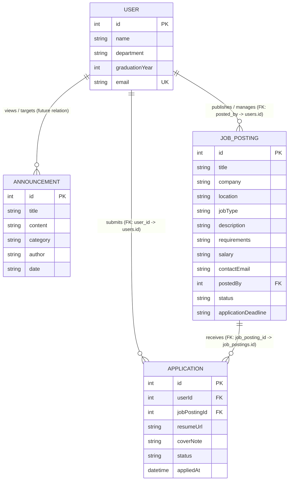
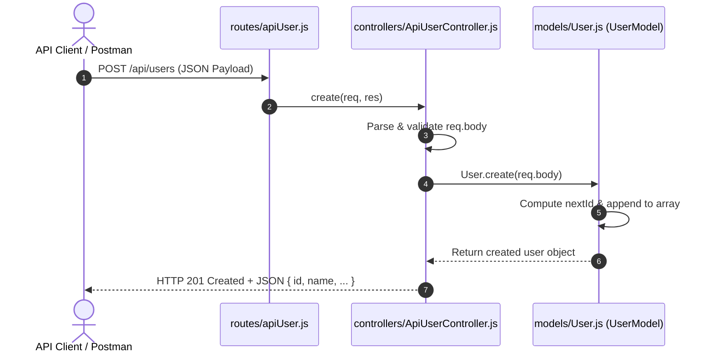
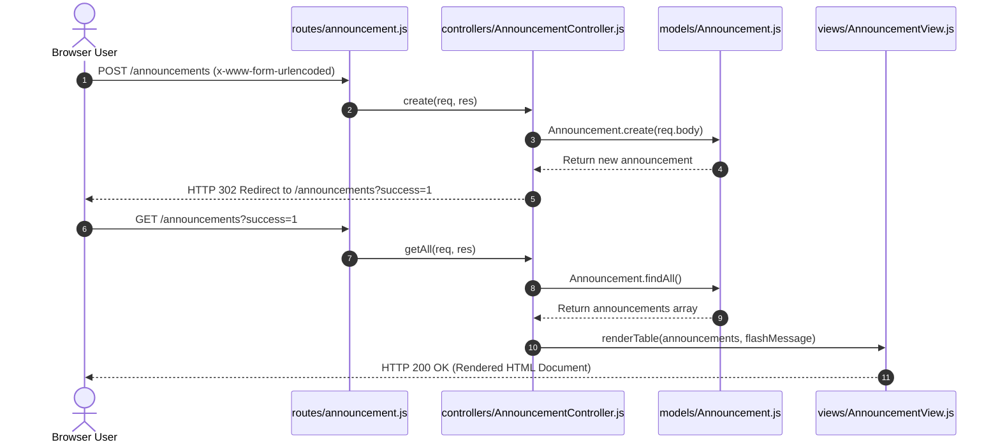

# 📊 Data Design Documentation (DDD)
> **Alumni Tracking System**  
> *Version:* 1.0.0  
> *Scope:* Data Architecture, Domain Models, In-Memory Storage, and Relational Database Transition Blueprint  
> *Target Audience:* Software Engineers, Architects, Course Evaluators, and Autonomous AI Agents  
> 🔗 **System Overview & MVC Manual:** [README.md](./README.md)

---

## 📑 Table of Contents
1. [Overview & Architectural Context](#1-overview--architectural-context)
2. [Domain Entities & Information Schema](#2-domain-entities--information-schema)
   - [User (Alumni) Entity](#21-user-alumni-entity)
   - [Announcement Entity](#22-announcement-entity)
   - [Job Posting Entity](#23-job-posting-entity)
   - [Application Action Entity (User-Job Action Table)](#24-application-action-entity-user-job-action-table)
   - [Entity-Relationship Diagram (ERD)](#25-entity-relationship-diagram-erd)
3. [Storage Implementation & Database Connection Architecture](#3-storage-implementation--database-connection-architecture)
   - [PostgreSQL Database Connection (`models/db.js`)](#31-postgresql-database-connection-modelsdbjs)
   - [Resolution of Data Volatility ("The Forgetting Test" Resolved)](#32-resolution-of-data-volatility-the-forgetting-test-resolved)
4. [Model Interface & CRUD Operations Contract](#4-model-interface--crud-operations-contract)
   - [UserModel CRUD Interface](#41-usermodel-crud-interface)
   - [AnnouncementModel CRUD Interface](#42-announcementmodel-crud-interface)
   - [JobPostingModel CRUD Interface](#43-jobpostingmodel-crud-interface)
   - [ApplicationModel CRUD Interface](#44-applicationmodel-crud-interface)
5. [Data Flow & Lifecycle across the MVC Architecture](#5-data-flow--lifecycle-across-the-mvc-architecture)
   - [RESTful JSON API Data Flow](#51-restful-json-api-data-flow)
   - [Web Interface Form Submission Data Flow](#52-web-interface-form-submission-data-flow)
6. [Relational Database (PostgreSQL) Transition Blueprint](#6-relational-database-postgresql-transition-blueprint)
   - [PostgreSQL DDL Schemas](#61-postgresql-ddl-schemas)
   - [Constraints & Indexing Strategy](#62-constraints--indexing-strategy)
   - [Database Migrations Architecture (`migrations/`)](#63-database-migrations-architecture-migrations)
   - [Docker Compose PostgreSQL Service Configuration](#64-docker-compose-postgresql-service-configuration)
   - [Data Factories & Database Seeding Architecture (`factories/` & `scripts/seed.js`)](#65-data-factories--database-seeding-architecture-factories--scriptsseedjs)
7. [Validation, Sanitization & Data Integrity Rules](#7-validation-sanitization--data-integrity-rules)
8. [AI Agent Quick Reference & Query Matrix](#8-ai-agent-quick-reference--query-matrix)

---

## 1. Overview & Architectural Context

The **Alumni Tracking System** is built on a clean **Model-View-Controller (MVC)** pattern. Within this architecture, the **Model Layer** ([`models/User.js`](file:///Users/hakanural06/alumni/models/User.js) and [`models/Announcement.js`](file:///Users/hakanural06/alumni/models/Announcement.js)) encapsulates all domain knowledge, validation, entity definitions, and data mutations.

### Key Design Principles:
- **Decoupled Persistence:** Business logic inside Controllers communicates strictly with Model class methods (`findAll`, `findById`, `create`, `update`, `delete`). Controllers remain agnostic to whether data originates from local process memory, a mock store, or a relational database (PostgreSQL).
- **Single Source of Truth:** Singleton instances of models are exported across the application, guaranteeing consistent state across both Web views and RESTful API endpoints during runtime.
- **Machine Readability:** This document specifies schema types, validation bounds, method contracts, and lifecycle behavior to enable autonomous AI agents to reason about, test, and refactor the data layer without breaking existing behavior.

---

## 2. Domain Entities & Information Schema

The system manages four core domain entities and action tables: **User (Alumni)**, **Announcement**, **Job Posting**, and **Application** (Action table connecting Users and Job Postings).

### 2.1 User (Alumni) Entity

Represents an individual graduate of the institution.

| Attribute | Data Type | Constraint | Default Value | Description |
| :--- | :--- | :--- | :--- | :--- |
| `id` | `Integer` | Primary Key, Auto-increment, Unique | Dynamic (`max(id) + 1`) | Unique identifier for the alumni member. |
| `name` | `String` | Required, Min 1, Max 100 chars | `'Yeni Mezun'` | Full name of the alumni member. |
| `department` | `String` | Required, Enum / Standard string | `'Computer Engineering'` | Academic department from which the user graduated. |
| `graduationYear` | `Integer` | Required, Range: 1900–2100 | `2024` | Calendar year of graduation. Cast to `Number`. |
| `email` | `String` | Required, Email format | `[name]@alumni.edu` (slugified) | Primary email address for contact and notifications. |

#### JSON Representation
```json
{
  "id": 1,
  "name": "Hakan Ural",
  "department": "Computer Engineering",
  "graduationYear": 2024,
  "email": "hakan@alumni.edu"
}
```

---

### 2.2 Announcement Entity

Represents institutional notices, alumni homecoming invitations, career opportunities, and academic grants.

| Attribute | Data Type | Constraint | Default Value | Description |
| :--- | :--- | :--- | :--- | :--- |
| `id` | `Integer` | Primary Key, Auto-increment, Unique | Dynamic (`max(id) + 1`) | Unique identifier for the announcement. |
| `title` | `String` | Required, Min 3, Max 200 chars | `'New Announcement'` | Headline / title of the posting. |
| `content` | `String` | Optional / Text | `""` | Detailed description or body of the notice. |
| `category` | `String` | Required, Categorical | `'General'` | Category tag: `Event`, `Career`, `Academic`, `General`. |
| `author` | `String` | Required, Min 2 chars | `'Alumni Office'` | Publishing entity, office, or individual. |
| `date` | `String` | ISO 8601 Date format (`YYYY-MM-DD`) | Today (`new Date().toISOString().split('T')[0]`) | Effective publication or event date. |

#### JSON Representation
```json
{
  "id": 1,
  "title": "Annual Alumni Homecoming 2026",
  "content": "Join us on campus for keynote speeches, networking cocktails, and department visits.",
  "category": "Event",
  "author": "Alumni Office",
  "date": "2026-10-15"
}
```

---

### 2.3 Job Posting Entity

Represents career opportunities, internships, and professional roles shared within the alumni network by graduates, partner organizations, and university career coordinators.

| Attribute | Data Type | Constraint | Default Value | Description |
| :--- | :--- | :--- | :--- | :--- |
| `id` | `Integer` | Primary Key, Auto-increment, Unique | Dynamic (`max(id) + 1`) | Unique identifier for the job posting. |
| `title` | `String` | Required, Min 3, Max 200 chars | `'Software Engineer'` | Title or headline of the job opportunity. |
| `company` | `String` | Required, Min 2, Max 150 chars | `'Partner Company'` | Name of the hiring company or institution. |
| `location` | `String` | Required, Max 150 chars | `'Remote'` | Workplace location (e.g., `'Istanbul, Turkey'`, `'Remote'`, `'Hybrid'`). |
| `jobType` | `String` | Required, Enum: `Full-time`, `Part-time`, `Contract`, `Internship`, `Remote` | `'Full-time'` | Employment type classification. |
| `description` | `String` | Optional / Text | `""` | In-depth description of responsibilities and scope. |
| `requirements` | `String` | Optional / Text | `""` | Required qualifications, skills, and experience criteria. |
| `salary` | `String` | Optional, Max 100 chars | `null` | Disclosed compensation or range (e.g., `'$90,000 - $120,000'`). |
| `contactEmail` | `String` | Required, RFC 5322 Email format | `'careers@company.com'` | Contact or submission email for applications. |
| `postedBy` | `Integer` | Foreign Key referencing `users(id)`, Nullable | `null` | Identifier of the alumni member or administrator posting the role. |
| `status` | `String` | Required, Enum: `Active`, `Closed`, `Draft` | `'Active'` | Operational state of the job listing. |
| `applicationDeadline` | `String` | Optional, ISO 8601 Date (`YYYY-MM-DD`) | `null` | Cutoff date for receiving applications. |
| `createdAt` | `String` | ISO 8601 Timestamp | Current Timestamp | Record creation timestamp. |
| `updatedAt` | `String` | ISO 8601 Timestamp | Current Timestamp | Record last update timestamp. |

#### JSON Representation
```json
{
  "id": 1,
  "title": "Senior Backend Engineer (Node.js / PostgreSQL)",
  "company": "TechCorp Innovations",
  "location": "Istanbul / Hybrid",
  "jobType": "Full-time",
  "description": "We are seeking a senior backend engineer to scale our distributed cloud services and database infrastructure.",
  "requirements": "3+ years Node.js, Express, PostgreSQL, Docker, and REST API design experience.",
  "salary": "₺85,000 - ₺110,000 / month",
  "contactEmail": "careers@techcorp.com",
  "postedBy": 1,
  "status": "Active",
  "applicationDeadline": "2026-12-31"
}
```

---

---

### 2.4 Application Action Entity (User-Job Action Table)

Represents the concrete action of an alumni member applying to a published job posting. Acts as an action/junction table governing the Many-to-Many relationship between `users` and `job_postings` with transactional status tracking.

| Attribute | Data Type | Constraint | Default Value | Description |
| :--- | :--- | :--- | :--- | :--- |
| `id` | `Integer` | Primary Key, Auto-increment, Unique | Dynamic (`max(id) + 1`) | Unique identifier for the application record. |
| `userId` / `user_id` | `Integer` | Foreign Key referencing `users(id)`, Cascade Delete | Required | ID of the alumni candidate submitting the application. |
| `jobPostingId` / `job_posting_id`| `Integer` | Foreign Key referencing `job_postings(id)`, Cascade Delete | Required | ID of the target job posting. |
| `resumeUrl` / `resume_url` | `String` | Optional, URL or document path, Max 500 chars | `null` | Link or storage location of candidate resume. |
| `coverNote` / `cover_note` | `String` | Optional / Text | `""` | Accompanying cover note, bio, or message. |
| `status` | `String` | Required, Enum: `Submitted`, `Pending`, `Under Review`, `Reviewed`, `Interviewing`, `Accepted`, `Rejected`, `Withdrawn` | `'Submitted'` | Lifecycle evaluation status of application. |
| `appliedAt` / `applied_at` | `String` | ISO 8601 Timestamp | Current Timestamp | Submission date and time. |
| `createdAt` | `String` | ISO 8601 Timestamp | Current Timestamp | Record creation timestamp. |
| `updatedAt` | `String` | ISO 8601 Timestamp | Current Timestamp | Record last update timestamp. |

> 🔒 **Composite Uniqueness:** Each user can only submit one application per job posting (`UNIQUE(user_id, job_posting_id)`).

#### JSON Representation
```json
{
  "id": 1,
  "userId": 2,
  "jobPostingId": 1,
  "resumeUrl": "https://storage.alumni.edu/resumes/ayse_yilmaz_cv.pdf",
  "coverNote": "I have 3 years of hands-on experience in backend microservices and would love to contribute to TechCorp.",
  "status": "Pending",
  "appliedAt": "2026-10-21T09:30:00.000Z"
}
```

---

### 2.5 Entity-Relationship Diagram (ERD)



> [!NOTE]
> `APPLICATION` serves as the explicit action entity between `USER` and `JOB_POSTING`:
> - A user can submit multiple applications across various job listings (`1:N`).
> - A job listing can receive multiple applications from diverse alumni (`1:N`).
> - `uq_user_job_application` constraint guarantees that a user cannot duplicate applications for the same role.

---

## 3. Storage Implementation & Database Connection Architecture

### 3.1 PostgreSQL Database Connection (`models/db.js`)
The Model Layer connects to PostgreSQL via a dedicated connection pooling module:
- **Source Code Locations:** [`models/db.js`](file:///Users/hakanural06/alumni/models/db.js), [`models/User.js`](file:///Users/hakanural06/alumni/models/User.js), [`models/Announcement.js`](file:///Users/hakanural06/alumni/models/Announcement.js), [`models/JobPosting.js`](file:///Users/hakanural06/alumni/models/JobPosting.js), and [`models/Application.js`](file:///Users/hakanural06/alumni/models/Application.js).
- **Storage Mechanism:** Relational persistence in PostgreSQL 16 (`users`, `announcements`, `job_postings`, and `applications` tables) mounted via Docker volume `pgdata`.
- **Connection Pool:** `pg.Pool` with connection pooling, parameterized queries (`$1, $2, ...`) for SQL injection prevention, idle timeout management, and `allowExitOnIdle: true` for clean event-loop lifecycle.
- **Graceful Fallback:** If the database connection is unreachable or during isolated offline tests, models gracefully fall back to in-memory state without crashing.

### 3.2 Resolution of Data Volatility ("The Forgetting Test" Resolved)

```
[Container / Process Lifecycle with PostgreSQL Persistence]
┌──────────────────────────────────────────────┐
│ Express Web Application Container            │
│  - Controllers invoke async Model CRUD       │
└──────────────────────────────────────────────┘
                       │
             TCP / Pool Connection (5432)
                       ▼
┌──────────────────────────────────────────────┐
│ PostgreSQL Container (db)                    │
│  - Tables: users, announcements,             │
│    job_postings, applications, migrations    │
└──────────────────────────────────────────────┘
                       │
       docker compose down / process kill
                       ▼
┌──────────────────────────────────────────────┐
│ Named Docker Volume: pgdata                  │
│  * ALL DATA PERSISTED! NO AMNESIA!           │
└──────────────────────────────────────────────┘
```

---

## 4. Model Interface & CRUD Operations Contract

All domain models implement a uniform, asynchronous CRUD contract returning Promises resolving to JavaScript Objects or Arrays.

### 4.1 UserModel CRUD Interface

```typescript
interface UserModelContract {
  create(userData: {
    name?: string;
    department?: string;
    graduationYear?: number | string;
    email?: string;
  }): Promise<User>;

  findAll(): Promise<User[]>;

  findById(id: number | string): Promise<User | null>;

  update(
    id: number | string,
    updateData: {
      name?: string;
      department?: string;
      graduationYear?: number | string;
      email?: string;
    }
  ): Promise<User | null>;

  delete(id: number | string): Promise<User | null>;
}
```

- **`create(userData)`:** Executes `INSERT INTO users (...) VALUES (...) RETURNING ...` with `ON CONFLICT (email)` update safety, returns the newly created or updated record.
- **`findAll()`:** Executes `SELECT id, name, department, graduation_year AS "graduationYear", email, created_at, updated_at FROM users ORDER BY id ASC`.
- **`findById(id)`:** Executes parameterized `SELECT ... FROM users WHERE id = $1`.
- **`update(id, updateData)`:** Executes parameterized `UPDATE users SET ... WHERE id = $... RETURNING ...`.
- **`delete(id)`:** Executes `DELETE FROM users WHERE id = $1 RETURNING ...`.

### 4.2 AnnouncementModel CRUD Interface

```typescript
interface AnnouncementModelContract {
  create(data: {
    title?: string;
    content?: string;
    category?: string;
    author?: string;
    date?: string;
  }): Promise<Announcement>;

  findAll(): Promise<Announcement[]>;

  findById(id: number | string): Promise<Announcement | null>;

  update(
    id: number | string,
    updateData: {
      title?: string;
      content?: string;
      category?: string;
      author?: string;
      date?: string;
    }
  ): Promise<Announcement | null>;

  delete(id: number | string): Promise<Announcement | null>;
}
```

- **`create(data)`:** Executes parameterized `INSERT INTO announcements (title, content, category, author, publication_date) VALUES ($1, $2, $3, $4, $5) RETURNING ...`.
- **`findAll()`:** Executes `SELECT id, title, content, category, author, publication_date AS date, created_at, updated_at FROM announcements ORDER BY id ASC`.
- **`findById(id)`:** Executes parameterized `SELECT ... FROM announcements WHERE id = $1`.
- **`update(id, updateData)`:** Executes parameterized `UPDATE announcements SET ... WHERE id = $... RETURNING ...`.
- **`delete(id)`:** Executes `DELETE FROM announcements WHERE id = $1 RETURNING ...`.

### 4.3 JobPostingModel CRUD Interface

```typescript
interface JobPostingModelContract {
  create(data: {
    title: string;
    company: string;
    location?: string;
    jobType?: 'Full-time' | 'Part-time' | 'Contract' | 'Internship' | 'Remote';
    description?: string;
    requirements?: string;
    salary?: string | null;
    contactEmail: string;
    postedBy?: number | string | null;
    status?: 'Active' | 'Closed' | 'Draft';
    applicationDeadline?: string | null;
  }): Promise<JobPosting>;

  findAll(filters?: {
    status?: string;
    jobType?: string;
    company?: string;
    postedBy?: number | string;
  }): Promise<JobPosting[]>;

  findById(id: number | string): Promise<JobPosting | null>;

  findByCompany(company: string): Promise<JobPosting[]>;

  update(
    id: number | string,
    updateData: {
      title?: string;
      company?: string;
      location?: string;
      jobType?: string;
      description?: string;
      requirements?: string;
      salary?: string | null;
      contactEmail?: string;
      postedBy?: number | string | null;
      status?: string;
      applicationDeadline?: string | null;
    }
  ): Promise<JobPosting | null>;

  delete(id: number | string): Promise<JobPosting | null>;
}
```

- **`create(data)`:** Executes parameterized `INSERT INTO job_postings (title, company, location, job_type, description, requirements, salary, contact_email, posted_by, status, application_deadline) VALUES ($1, $2, $3, $4, $5, $6, $7, $8, $9, $10, $11) RETURNING ...`.
- **`findAll(filters)`:** Executes `SELECT id, title, company, location, job_type AS "jobType", description, requirements, salary, contact_email AS "contactEmail", posted_by AS "postedBy", status, application_deadline AS "applicationDeadline", created_at, updated_at FROM job_postings` with dynamic WHERE clauses for optional filtering.
- **`findById(id)`:** Executes parameterized `SELECT ... FROM job_postings WHERE id = $1`.
- **`findByCompany(company)`:** Executes `SELECT ... FROM job_postings WHERE LOWER(company) LIKE LOWER($1)`.
- **`update(id, updateData)`:** Executes parameterized `UPDATE job_postings SET ... WHERE id = $... RETURNING ...`.
- **`delete(id)`:** Executes `DELETE FROM job_postings WHERE id = $1 RETURNING ...`.

### 4.4 ApplicationModel CRUD Interface

```typescript
interface ApplicationModelContract {
  create(data: {
    userId: number | string;
    jobPostingId: number | string;
    resumeUrl?: string | null;
    coverNote?: string;
    status?: 'Pending' | 'Reviewed' | 'Accepted' | 'Rejected' | 'Withdrawn';
  }): Promise<Application>;

  findAll(filters?: {
    userId?: number | string;
    jobPostingId?: number | string;
    status?: string;
  }): Promise<Application[]>;

  findById(id: number | string): Promise<Application | null>;

  findByIdWithDetails(id: number | string): Promise<Application | null>;

  findByUser(userId: number | string): Promise<Application[]>;

  findByJob(jobPostingId: number | string): Promise<Application[]>;

  update(
    id: number | string,
    updateData: {
      status?: string;
      resumeUrl?: string | null;
      coverNote?: string;
    }
  ): Promise<Application | null>;

  delete(id: number | string): Promise<Application | null>;
}
```

- **`create(data)`:** Executes parameterized `INSERT INTO applications (user_id, job_posting_id, resume_url, cover_note, status) VALUES ($1, $2, $3, $4, $5) ON CONFLICT (user_id, job_posting_id) DO UPDATE SET resume_url = EXCLUDED.resume_url, cover_note = EXCLUDED.cover_note, updated_at = CURRENT_TIMESTAMP RETURNING id, user_id AS "userId", job_posting_id AS "jobPostingId", resume_url AS "resumeUrl", cover_note AS "coverNote", status, applied_at AS "appliedAt", created_at, updated_at;`.
- **`findAll(filters)`:** Executes parameterized query against `applications` with dynamic filtering by `userId`, `jobPostingId`, or `status`, ordered by `id DESC`.
- **`findById(id)`:** Executes parameterized `SELECT ... FROM applications WHERE id = $1`.
- **`findByIdWithDetails(id)`:** Executes JOIN query across `applications`, `users`, and `job_postings` to eagerly load candidate name/email and job title/company.
- **`findByUser(userId)`:** Executes parameterized `SELECT ... FROM applications WHERE user_id = $1`.
- **`findByJob(jobPostingId)`:** Executes parameterized `SELECT ... FROM applications WHERE job_posting_id = $1`.
- **`update(id, updateData)`:** Executes parameterized `UPDATE applications SET status = $1, resume_url = $2, cover_note = $3, updated_at = CURRENT_TIMESTAMP WHERE id = $4 RETURNING ...`.
- **`delete(id)`:** Executes `DELETE FROM applications WHERE id = $1 RETURNING ...`.

---

## 5. Data Flow & Lifecycle across the MVC Architecture

### 5.1 RESTful JSON API Data Flow



### 5.2 Web Interface Form Submission Data Flow



---

## 6. Relational Database (PostgreSQL) Transition Blueprint

To resolve the data amnesia demonstrated in the "Forgetting Test", the data layer is architected for seamless migration to PostgreSQL.

### 6.1 PostgreSQL DDL Schemas

```sql
-- Enable UUID extension if UUID identifiers are desired in the future
CREATE EXTENSION IF NOT EXISTS "uuid-ossp";

-- Table: users (Alumni Records)
CREATE TABLE IF NOT EXISTS users (
    id SERIAL PRIMARY KEY,
    name VARCHAR(120) NOT NULL,
    department VARCHAR(150) NOT NULL DEFAULT 'Computer Engineering',
    graduation_year SMALLINT NOT NULL CHECK (graduation_year >= 1900 AND graduation_year <= 2100),
    email VARCHAR(255) NOT NULL UNIQUE,
    created_at TIMESTAMP WITH TIME ZONE DEFAULT CURRENT_TIMESTAMP,
    updated_at TIMESTAMP WITH TIME ZONE DEFAULT CURRENT_TIMESTAMP
);

-- Table: announcements (Bulletins & Notices)
CREATE TABLE IF NOT EXISTS announcements (
    id SERIAL PRIMARY KEY,
    title VARCHAR(200) NOT NULL,
    content TEXT DEFAULT '',
    category VARCHAR(50) NOT NULL DEFAULT 'General',
    author VARCHAR(100) NOT NULL DEFAULT 'Alumni Office',
    publication_date DATE NOT NULL DEFAULT CURRENT_DATE,
    created_at TIMESTAMP WITH TIME ZONE DEFAULT CURRENT_TIMESTAMP,
    updated_at TIMESTAMP WITH TIME ZONE DEFAULT CURRENT_TIMESTAMP
);

-- Optional trigger function to automatically update updated_at timestamp
CREATE OR REPLACE FUNCTION update_timestamp()
RETURNS TRIGGER AS $$
BEGIN
    NEW.updated_at = CURRENT_TIMESTAMP;
    RETURN NEW;
END;
$$ LANGUAGE plpgsql;

CREATE TRIGGER trg_users_update
    BEFORE UPDATE ON users
    FOR EACH ROW
    EXECUTE FUNCTION update_timestamp();

CREATE TRIGGER trg_announcements_update
    BEFORE UPDATE ON announcements
    FOR EACH ROW
    EXECUTE FUNCTION update_timestamp();

-- Table: job_postings (Career & Internship Listings)
CREATE TABLE IF NOT EXISTS job_postings (
    id SERIAL PRIMARY KEY,
    title VARCHAR(200) NOT NULL,
    company VARCHAR(150) NOT NULL,
    location VARCHAR(150) NOT NULL DEFAULT 'Remote',
    job_type VARCHAR(50) NOT NULL DEFAULT 'Full-time' CHECK (job_type IN ('Full-time', 'Part-time', 'Contract', 'Internship', 'Remote')),
    description TEXT DEFAULT '',
    requirements TEXT DEFAULT '',
    salary VARCHAR(100) DEFAULT NULL,
    contact_email VARCHAR(255) NOT NULL,
    posted_by INTEGER REFERENCES users(id) ON DELETE SET NULL,
    status VARCHAR(20) NOT NULL DEFAULT 'Active' CHECK (status IN ('Active', 'Closed', 'Draft')),
    application_deadline DATE DEFAULT NULL,
    created_at TIMESTAMP WITH TIME ZONE DEFAULT CURRENT_TIMESTAMP,
    updated_at TIMESTAMP WITH TIME ZONE DEFAULT CURRENT_TIMESTAMP
);

CREATE TRIGGER trg_job_postings_update
    BEFORE UPDATE ON job_postings
    FOR EACH ROW
    EXECUTE FUNCTION update_timestamp();

-- Table: applications (Action Table: Alumni Job Applications)
CREATE TABLE IF NOT EXISTS applications (
    id SERIAL PRIMARY KEY,
    user_id INTEGER NOT NULL REFERENCES users(id) ON DELETE CASCADE,
    job_posting_id INTEGER NOT NULL REFERENCES job_postings(id) ON DELETE CASCADE,
    resume_url VARCHAR(500) DEFAULT NULL,
    cover_note TEXT DEFAULT '',
    status VARCHAR(30) NOT NULL DEFAULT 'Submitted' CHECK (status IN ('Submitted', 'Pending', 'Under Review', 'Reviewed', 'Interviewing', 'Accepted', 'Rejected', 'Withdrawn')),
    applied_at TIMESTAMP WITH TIME ZONE DEFAULT CURRENT_TIMESTAMP,
    created_at TIMESTAMP WITH TIME ZONE DEFAULT CURRENT_TIMESTAMP,
    updated_at TIMESTAMP WITH TIME ZONE DEFAULT CURRENT_TIMESTAMP,
    CONSTRAINT uq_user_job_application UNIQUE (user_id, job_posting_id)
);

CREATE TRIGGER trg_applications_update
    BEFORE UPDATE ON applications
    FOR EACH ROW
    EXECUTE FUNCTION update_timestamp();
```

### 6.2 Constraints & Indexing Strategy

| Table | Index Name | Column(s) | Type | Purpose |
| :--- | :--- | :--- | :--- | :--- |
| `users` | `idx_users_email` | `email` | `BTREE UNIQUE` | Fast lookup during login/search; enforces email uniqueness. |
| `users` | `idx_users_dept_year` | `(department, graduation_year)` | `BTREE` | Accelerates directory filtering by department and graduating class. |
| `announcements` | `idx_announcements_date` | `publication_date DESC` | `BTREE` | Fast retrieval of latest announcements on the home/feed view. |
| `announcements` | `idx_announcements_cat` | `category` | `BTREE` | Efficient filtering by event/career category tags. |
| `job_postings` | `idx_job_postings_posted_by` | `posted_by` | `BTREE` | Accelerates lookups of postings created by specific alumni. |
| `job_postings` | `idx_job_postings_status` | `status` | `BTREE` | Fast retrieval of active listings for public feeds. |
| `job_postings` | `idx_job_postings_type` | `job_type` | `BTREE` | Speeds up filtering by employment type (e.g. Remote, Internship). |
| `job_postings` | `idx_job_postings_company` | `company` | `BTREE` | Accelerates corporate partner and company searches. |
| `job_postings` | `idx_job_postings_created_at` | `created_at DESC` | `BTREE` | High performance retrieval for latest job feed orderings. |
| `applications` | `uq_user_job_application` | `(user_id, job_posting_id)` | `BTREE UNIQUE` | Enforces one application per alumni per job posting. |
| `applications` | `idx_applications_user_id` | `user_id` | `BTREE` | Accelerates lookups of all applications by a candidate. |
| `applications` | `idx_applications_job_id` | `job_posting_id` | `BTREE` | Accelerates candidate review queries for a job. |
| `applications` | `idx_applications_status` | `status` | `BTREE` | Fast filtering of application status (Pending, Accepted, etc.). |
| `applications` | `idx_applications_applied_at` | `applied_at DESC` | `BTREE` | Orders applications chronologically. |

### 6.3 Database Migrations Architecture (`migrations/`)

The application adopts an idempotent SQL migration strategy with automatic execution capabilities:

```
migrations/
├── 001_create_tables.sql              # DDL: creates users, announcements, indexes, triggers
├── 002_seed_data.sql                  # DML: seeds initial 3 users and 3 announcements
├── 003_create_job_postings_table.sql  # DDL: creates job_postings table, indexes, triggers
└── 004_create_applications_table.sql  # DDL: creates applications action table, indexes, triggers
```

#### Migration Lifecycle & Execution Methods:
1. **Docker Automatic Execution (`/docker-entrypoint-initdb.d`):**
   When PostgreSQL container starts for the first time, all `.sql` files mounted in `/docker-entrypoint-initdb.d` are automatically executed in alphabetical order.
2. **Node.js Migration Runner (`scripts/migrate.js`):**
   Can be run manually via `npm run migrate` anytime against local or remote PostgreSQL. Tracks applied scripts in the `schema_migrations` table to guarantee idempotency.

```sql
-- Migration tracking table
CREATE TABLE IF NOT EXISTS schema_migrations (
    id SERIAL PRIMARY KEY,
    name VARCHAR(255) NOT NULL UNIQUE,
    applied_at TIMESTAMP WITH TIME ZONE DEFAULT CURRENT_TIMESTAMP
);
```

### 6.4 Docker Compose PostgreSQL Service Configuration

The updated `docker-compose.yml` mounts the persistent volume (`pgdata`) and the `migrations/` directory for automatic startup initialization:

```yaml
services:
  web:
    build: .
    ports:
      - "3000:3000"
    environment:
      - PORT=3000
      - DATABASE_URL=postgres://alumni_user:alumni_password@db:5432/alumni_db
    depends_on:
      - db

  db:
    image: postgres:16-alpine
    restart: always
    environment:
      POSTGRES_USER: alumni_user
      POSTGRES_PASSWORD: alumni_password
      POSTGRES_DB: alumni_db
    ports:
      - "5432:5432"
    volumes:
      - pgdata:/var/lib/postgresql/data
      - ./migrations:/docker-entrypoint-initdb.d:ro

volumes:
  pgdata:
```

### 6.5 Data Factories & Database Seeding Architecture (`factories/` & `scripts/seed.js`)

To facilitate reproducible testing, automated benchmarks, and reliable data population during development and CI/CD, the system implements the **Factory Pattern** and an automated **Database Seeder** tool:

```
factories/
├── UserFactory.js          # Generates single / bulk valid alumni records
├── AnnouncementFactory.js  # Generates single / bulk valid announcement records
├── JobPostingFactory.js    # Generates single / bulk valid job postings
└── index.js                # Aggregates and exports all factories
```

#### Factory Contracts:
- **`UserFactory.create(overrides = {})`**: Generates a mock `User` object with valid name, department, graduation year, and unique email.
- **`UserFactory.createMany(count, overrides = {})`**: Generates `count` unique user objects.
- **`UserFactory.createInDb(client, overrides = {})`**: Persists the generated user record directly into PostgreSQL with `ON CONFLICT (email)` safety.
- **`AnnouncementFactory.create(overrides = {})`**: Generates a mock `Announcement` object with category, content, author, and date.
- **`AnnouncementFactory.createMany(count, overrides = {})`**: Generates `count` unique announcement objects.
- **`AnnouncementFactory.createInDb(client, overrides = {})`**: Persists the generated announcement directly into PostgreSQL.
- **`JobPostingFactory.create(overrides = {})`**: Generates a mock `JobPosting` object with title, company, location, jobType, description, requirements, salary, contactEmail, status, and deadline.
- **`JobPostingFactory.createMany(count, overrides = {})`**: Generates `count` unique job postings.
- **`JobPostingFactory.createInDb(client, overrides = {})`**: Persists the generated job posting directly into PostgreSQL.

#### Database Seeding Lifecycle (`npm run seed` / `scripts/seed.js`):
1. **Connect:** Establishes connection to PostgreSQL using `DATABASE_URL`.
2. **Seed Users:** Invokes `UserFactory.createInDb()` in a loop to populate 5 realistic alumni records.
3. **Seed Announcements:** Invokes `AnnouncementFactory.createInDb()` to populate 5 varied announcements across categories (`Event`, `Career`, `Academic`, `General`).
4. **Seed Job Postings:** Invokes `JobPostingFactory.createInDb()` to populate initial career opportunities linked to alumni.
5. **Synchronize In-Memory Stores:** Synchronizes `UserModel.users`, `AnnouncementModel.announcements`, and `JobPostingModel.jobPostings` if running within an active Node process.
6. **Idempotency:** Safe to run repeatedly; duplicate emails are handled gracefully via `ON CONFLICT` clauses.

---

## 7. Validation, Sanitization & Data Integrity Rules

| Field | Validation Rule | Error Response Code | Sanitization Handling |
| :--- | :--- | :--- | :--- |
| `user.name` | Required, string, trimmed length >= 1 | `400 Bad Request` | Trim whitespace, escape `<>&"` in HTML views. |
| `user.email` | RFC 5322 regex validation, unique | `400 Bad Request` | Lowercase conversion (`trim().toLowerCase()`). |
| `user.graduationYear` | Integer, 1900 <= year <= 2100 | `400 Bad Request` | Coerce via `Number(val)`. |
| `announcement.title` | Required, string, trimmed length >= 3 | `400 Bad Request` | Trim whitespace, strip malicious HTML tags. |
| `announcement.category`| Must match: `Event`, `Career`, `Academic`, `General` | `400 Bad Request` | Default to `'General'` if omitted. |
| `announcement.date` | ISO Date format `YYYY-MM-DD` | `400 Bad Request` | Default to `new Date().toISOString().split('T')[0]`. |
| `job_posting.title` | Required, string, trimmed length >= 3, max 200 | `400 Bad Request` | Trim whitespace, escape `<>&"` in HTML views. |
| `job_posting.company` | Required, string, trimmed length >= 2, max 150 | `400 Bad Request` | Trim whitespace. |
| `job_posting.location` | Required, string, max 150 | `400 Bad Request` | Default to `'Remote'` if omitted. |
| `job_posting.jobType` | Must match: `Full-time`, `Part-time`, `Contract`, `Internship`, `Remote` | `400 Bad Request` | Default to `'Full-time'`. |
| `job_posting.contactEmail` | RFC 5322 regex validation, valid email | `400 Bad Request` | Lowercase conversion (`trim().toLowerCase()`). |
| `job_posting.status` | Must match: `Active`, `Closed`, `Draft` | `400 Bad Request` | Default to `'Active'`. |
| `job_posting.applicationDeadline` | Optional, ISO Date format `YYYY-MM-DD` | `400 Bad Request` | Coerce to `YYYY-MM-DD` or `null`. |
| `application.userId` | Required, integer, references valid alumni user | `400 Bad Request` | Numeric casting. |
| `application.jobPostingId` | Required, integer, references valid job posting | `400 Bad Request` | Numeric casting. |
| `application.resumeUrl` | Optional string, URL/path format, max 500 chars | `400 Bad Request` | Trim whitespace. |
| `application.coverNote` | Optional text, max 2000 chars | `400 Bad Request` | Trim whitespace, escape HTML. |
| `application.status` | Must match: `Pending`, `Reviewed`, `Accepted`, `Rejected`, `Withdrawn` | `400 Bad Request` | Default to `'Pending'`. |

---

## 8. AI Agent Quick Reference & Query Matrix

This matrix provides AI agents with instant mappings between business actions, endpoints, controller methods, and model contracts:

| Target Resource | Action | Method | Route | Controller Call | Model Invocation |
| :--- | :--- | :--- | :--- | :--- | :--- |
| **User (API)** | List All | `GET` | `/api/users` | `ApiUserController.getAll` | `User.findAll()` |
| **User (API)** | Get One | `GET` | `/api/users/:id` | `ApiUserController.getById` | `User.findById(id)` |
| **User (API)** | Create | `POST` | `/api/users` | `ApiUserController.create` | `User.create(body)` |
| **User (API)** | Update | `PUT` / `PATCH` | `/api/users/:id` | `ApiUserController.update` | `User.update(id, body)` |
| **User (API)** | Delete | `DELETE` | `/api/users/:id` | `ApiUserController.delete` | `User.delete(id)` |
| **User (Web)** | Directory View | `GET` | `/users` | `UserController.getAll` | `User.findAll()` |
| **User (Web)** | Detail Card | `GET` | `/users/:id` | `UserController.getById` | `User.findById(id)` |
| **User (Web)** | Form Create | `POST` | `/users` | `UserController.create` | `User.create(body)` |
| **User (Web)** | Form Update | `POST` | `/users/:id/edit` | `UserController.update` | `User.update(id, body)` |
| **User (Web)** | Form Delete | `POST` | `/users/:id/delete`| `UserController.delete` | `User.delete(id)` |
| **Announcement (API)** | List All | `GET` | `/api/announcements` | `ApiAnnouncementController.getAll` | `Announcement.findAll()` |
| **Announcement (API)** | Get One | `GET` | `/api/announcements/:id` | `ApiAnnouncementController.getById` | `Announcement.findById(id)` |
| **Announcement (API)** | Create | `POST` | `/api/announcements` | `ApiAnnouncementController.create` | `Announcement.create(body)` |
| **Announcement (API)** | Update | `PUT` / `PATCH` | `/api/announcements/:id`| `ApiAnnouncementController.update` | `Announcement.update(id, body)` |
| **Announcement (API)** | Delete | `DELETE` | `/api/announcements/:id`| `ApiAnnouncementController.delete` | `Announcement.delete(id)` |
| **Announcement (Web)** | Dashboard View | `GET` | `/announcements` | `AnnouncementController.getAll` | `Announcement.findAll()` |
| **Announcement (Web)** | Detail Card | `GET` | `/announcements/:id` | `AnnouncementController.getById` | `Announcement.findById(id)` |
| **Announcement (Web)** | Form Create | `POST` | `/announcements` | `AnnouncementController.create` | `Announcement.create(body)` |
| **Announcement (Web)** | Form Update | `POST` | `/announcements/:id/edit` | `AnnouncementController.update` | `Announcement.update(id, body)` |
| **Announcement (Web)** | Form Delete | `POST` | `/announcements/:id/delete`| `AnnouncementController.delete` | `Announcement.delete(id)` |
| **Job Posting (API)** | List All | `GET` | `/api/jobs` | `ApiJobPostingController.getAll` | `JobPosting.findAll()` |
| **Job Posting (API)** | Get One | `GET` | `/api/jobs/:id` | `ApiJobPostingController.getById` | `JobPosting.findById(id)` |
| **Job Posting (API)** | Create | `POST` | `/api/jobs` | `ApiJobPostingController.create` | `JobPosting.create(body)` |
| **Job Posting (API)** | Update | `PUT` / `PATCH` | `/api/jobs/:id` | `ApiJobPostingController.update` | `JobPosting.update(id, body)` |
| **Job Posting (API)** | Delete | `DELETE` | `/api/jobs/:id` | `ApiJobPostingController.delete` | `JobPosting.delete(id)` |
| **Job Posting (Web)** | Board View | `GET` | `/jobs` | `JobPostingController.getAll` | `JobPosting.findAll()` |
| **Job Posting (Web)** | Detail Card | `GET` | `/jobs/:id` | `JobPostingController.getById` | `JobPosting.findById(id)` |
| **Job Posting (Web)** | Form Create | `POST` | `/jobs` | `JobPostingController.create` | `JobPosting.create(body)` |
| **Job Posting (Web)** | Form Update | `POST` | `/jobs/:id/edit` | `JobPostingController.update` | `JobPosting.update(id, body)` |
| **Job Posting (Web)** | Form Delete | `POST` | `/jobs/:id/delete` | `JobPostingController.delete` | `JobPosting.delete(id)` |
| **Job Posting (Nested API)** | List User's Jobs | `GET` | `/api/users/:userId/jobs` | `ApiJobPostingController.getAll` | `JobPosting.findByPostedBy(userId)` |
| **Job Posting (Nested API)** | Create for User | `POST` | `/api/users/:userId/jobs` | `ApiJobPostingController.create` | `JobPosting.create(body)` |
| **Job Posting (Nested API)** | Get One for User | `GET` | `/api/users/:userId/jobs/:id` | `ApiJobPostingController.getById` | `JobPosting.findById(id)` |
| **Job Posting (Nested API)** | Update for User | `PUT` / `PATCH` | `/api/users/:userId/jobs/:id` | `ApiJobPostingController.update` | `JobPosting.update(id, body)` |
| **Job Posting (Nested API)** | Delete for User | `DELETE` | `/api/users/:userId/jobs/:id` | `ApiJobPostingController.delete` | `JobPosting.delete(id)` |
| **Job Posting (Nested Web)** | View User's Jobs | `GET` | `/users/:userId/jobs` | `JobPostingController.getByUser` | `JobPosting.findByPostedBy(userId)` |
| **Application (Direct API)** | List All Applications | `GET` | `/api/applications` | `ApiApplicationController.getAll` | `Application.findAll()` |
| **Application (Direct API)** | Get One Application | `GET` | `/api/applications/:id` | `ApiApplicationController.getById` | `Application.findById(id)` |
| **Application (Direct API)** | Submit Application | `POST` | `/api/applications` | `ApiApplicationController.create` | `Application.create(body)` |
| **Application (Direct API)** | Update Application | `PUT` / `PATCH` | `/api/applications/:id` | `ApiApplicationController.update` | `Application.update(id, body)` |
| **Application (Direct API)** | Withdraw / Delete | `DELETE` | `/api/applications/:id` | `ApiApplicationController.delete` | `Application.delete(id)` |
| **Application (Nested User)**| List User's Applications| `GET` | `/api/users/:userId/applications` | `ApiApplicationController.getAll` | `Application.findByUser(userId)` |
| **Application (Nested User)**| Apply as User | `POST` | `/api/users/:userId/applications` | `ApiApplicationController.create` | `Application.create(body)` |
| **Application (Nested Job)** | List Job Candidates | `GET` | `/api/jobs/:jobId/applications` | `ApiApplicationController.getAll` | `Application.findByJob(jobId)` |
| **Application (Nested Job)** | Apply to Job | `POST` | `/api/jobs/:jobId/applications` | `ApiApplicationController.create` | `Application.create(body)` |
| **Application (Nested Job)** | Update Status | `PATCH` | `/api/jobs/:jobId/applications/:id`| `ApiApplicationController.partialUpdate`| `Application.update(id, body)` |
| **Application (Web View)** | Applications Board | `GET` | `/applications` | `ApplicationController.getAll` | `Application.findAll()` |
| **Application (Nested Web)** | My Applications View | `GET` | `/users/:userId/applications` | `ApplicationController.getByUser` | `Application.findByUser(userId)` |
| **Application (Nested Web)** | Candidates View | `GET` | `/jobs/:jobId/applications` | `ApplicationController.getByJob` | `Application.findByJob(jobId)` |

---
*Document automatically maintained and indexed for AI agents and developer tooling.*
